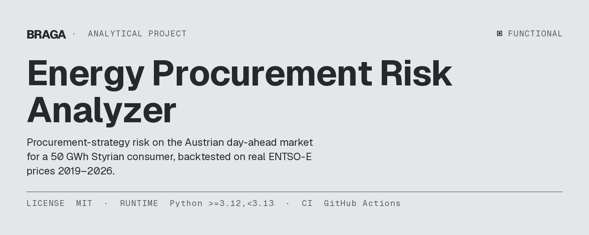
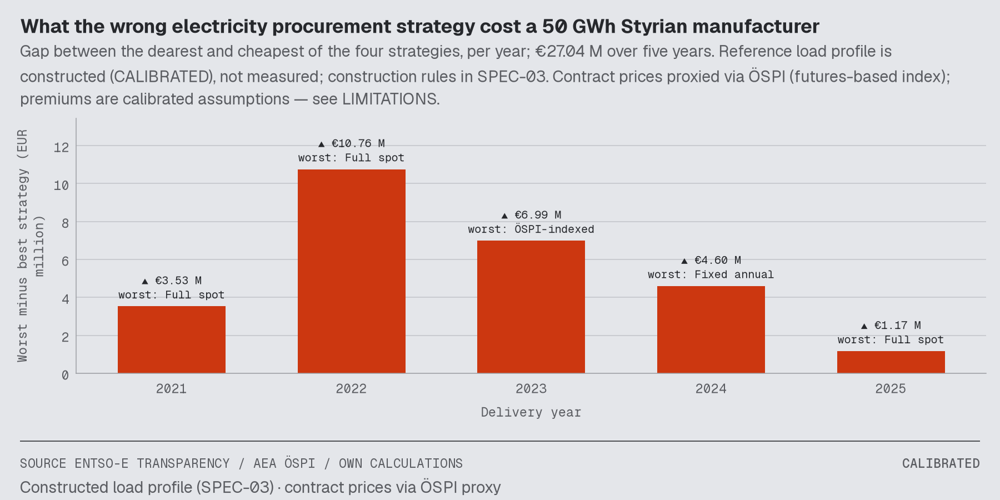
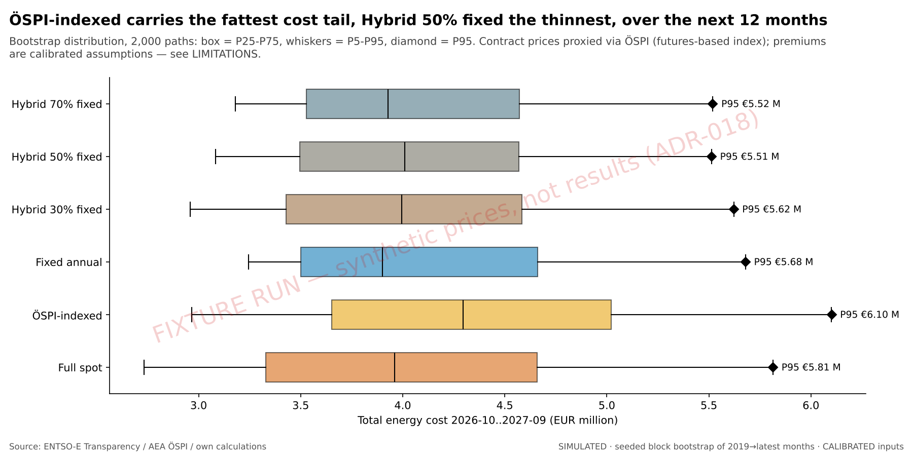
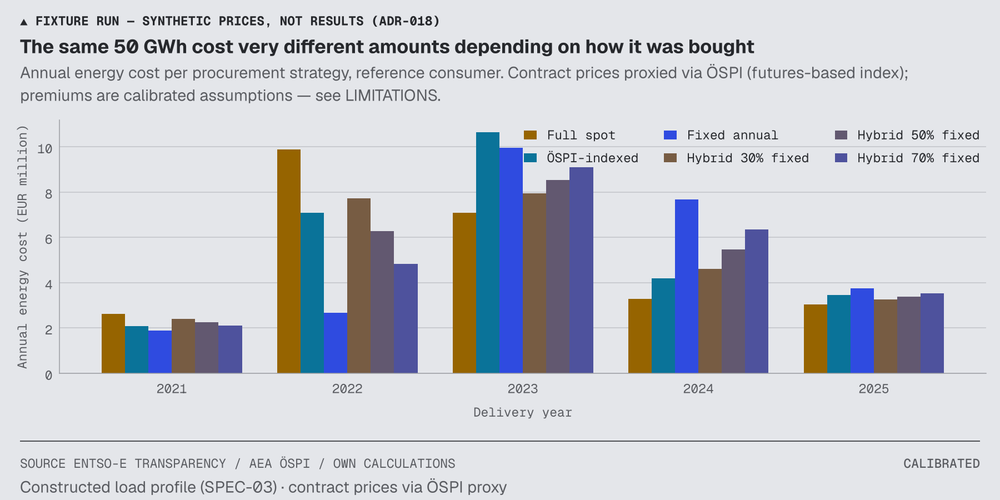
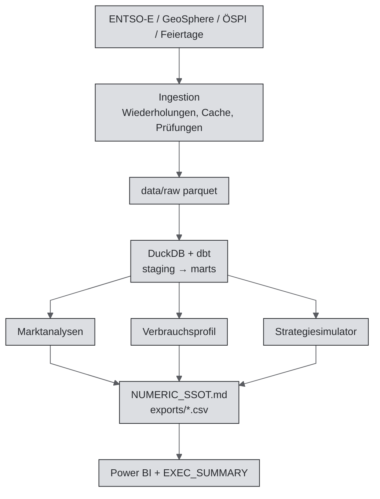

[🇧🇷 PT-BR](README.pt-BR.md) · [🇬🇧 EN-UK](README.md) · [🇦🇹 DE-AT](README.de-AT.md)

# Energie-Beschaffungsrisiko-Analyse (EPRA)



[](https://github.com/RafaelBraga-Kribitz/energy-procurement-risk-analyzer/actions/workflows/ci.yml)
[](https://www.python.org/downloads/release/python-3120/)
[](LICENSE)
[](#status)

**Status:** Funktionsfähig · Pipeline abgeschlossen und getestet; erster Lauf mit Echtdaten erfolgt; Power-BI-Aktualisierung in Desktop noch ausständig

Ein Energieeinkäufer oder Controller in einem Industrieunternehmen muss entscheiden, wie Strom beschafft wird. Seit der Energiekrise 2021–2023 ist diese Entscheidung in Österreich ein Risiko auf Vorstandsebene. Dieses Projekt beantwortet zwei Fragen für einen **steirischen Industrieverbraucher mit 50 GWh Jahresverbrauch** am **österreichischen Day-Ahead-Markt**. Dieser Markt setzt die stündlichen Preise für den Folgetag fest; die Preisdaten stammen von der ENTSO-E-Transparenzplattform. Was kostete die Wahl der Beschaffungsstrategie 2021–2025? Wie hoch ist das Kostenrisiko jeder Strategie für die kommenden zwölf Monate? Gemessen wird es als simulierte Jahreskosten am 95. Perzentil (P95), das in ungefähr einem von 20 Jahren überschritten wird.

**Wer entscheidet:** der Energieeinkäufer oder Controller eines steirischen Herstellers mit 50 GWh Verbrauch. Die [Executive Summary](reports/EXEC_SUMMARY.md) richtet sich an CFO und Einkaufsleitung. Der Verbraucher ist ein Referenzfall und kein reales Unternehmen.

**Was entschieden wird:** wie der Strom in den nächsten zwölf Monaten beschafft wird. Die sechs Optionen stehen unter [Fragestellung](#fragestellung).

**Ergebnis:**

<!-- epra:answer:start -->
Eine ungünstige Beschaffungsstrategie kostete den 50-GWh-Referenzverbraucher 2021–2025 insgesamt €27,04 Mio. (KALIBRIERT). Das ist die Summe der jährlichen Differenz zwischen der teuersten und der günstigsten von vier Strategien. Über die fünf Jahre war **Jahresfixpreis** mit Gesamtkosten von €30,17 Mio. (KALIBRIERT) am günstigsten. Für die kommenden zwölf Monate hat Jahresfixpreis die niedrigsten erwarteten Kosten (€4,77 Mio., SIMULIERT); Hybrid mit 70 % Fixpreis hat die niedrigste P95-Exposition: €6,44 Mio. (SIMULIERT) gegenüber €6,61 Mio. (SIMULIERT).
<!-- epra:answer:end -->

**Abwägung:** Ein Einkauf, der die erwarteten Kosten minimiert, kann anders entscheiden als einer, der die simulierten Jahreskosten am 95. Perzentil minimiert. Die Ergebnistabelle unten zeigt, ob sich die Auswahl unterscheidet. Die [Executive Summary](reports/EXEC_SUMMARY.md) nennt die Empfehlung für beide Entscheidungsprofile. Die Wahl hängt davon ab, wie viel Kostenrisiko akzeptiert wird.

**Wichtigster Vorbehalt:** Das Lastprofil der Anlage ist konstruiert, nicht gemessen (KALIBRIERT). Vertragspreise werden durch den ÖSPI-Index angenähert und stammen nicht aus Lieferantenangeboten. Die Werte für die nächsten zwölf Monate ziehen vergangene Preise neu (SIMULIERT); sie sind keine Preisprognose.

<!-- epra:chart:start -->

<!-- epra:chart:end -->
*Diagramm: die jährliche Differenz zwischen der teuersten und der günstigsten Strategie. Die Tabelle darunter und die Executive Summary enthalten die Zahlen.*

## Was das Tool macht

Das Tool berechnet die Kosten von vier Strombeschaffungsarten anhand realer Preise von 2021 bis 2025. Danach testet es jede Strategie mit 2.000 simulierten Zwölfmonatspfaden. Jede Kennzahl erhält eine von drei Kennzeichnungen:

- **VERIFIZIERT:** direkt aus realen Daten berechnet, ohne Modellierung.
- **KALIBRIERT:** dokumentierte Annahme, die an reale Daten angelehnt ist.
- **SIMULIERT:** Ergebnis eines reproduzierbar gestarteten Zufallsverfahrens.

## Warum es dieses Projekt gibt

Seit der Krise 2021–2023 ist die Strombeschaffung für Hersteller ein Risiko auf Vorstandsebene, dennoch übernehmen viele weiterhin das Angebot ihres Lieferanten. Dieses Projekt sollte einem CFO zeigen, welcher Anteil zu einem Fixpreis abgesichert werden sollte, gemessen an den Kosten am 95. Perzentil jeder Strategie. Die Bewertung vor dem Bau erwartete über drei jährliche Entscheidungen einen Entscheidungsnutzen von €77.000 bei zentralen Kosten von €6.373. Das entspricht Faktor 12 und erfüllt die finanzielle Hürde von Faktor 4. Beobachtetes Ergebnis: noch nicht gemessen; bisher hat kein Einkäufer das Tool eingesetzt. Details: [wirtschaftliche Bewertung](docs/economic-evaluation.md).

## Fragestellung

> **Wie viel kostete eine falsche Beschaffungsstrategie einen steirischen Hersteller mit 50 GWh in den Jahren 2021–2025?
> Wie hoch sind die simulierten Jahreskosten am 95. Perzentil für die kommenden zwölf Monate je Strategie?**

Das Projekt vergleicht vier Strategietypen ([Spezifikation des Simulators](docs/SPEC-05_strategy_simulator.md)).
Ein Typ, Hybrid, umfasst drei Aufteilungen; daher enthält die Ergebnistabelle sechs Zeilen.

| Strategie | Art der Beschaffung |
|---|---|
| Vollständig Spot | Jede Stunde zum österreichischen Day-Ahead-Preis |
| ÖSPI-indexiert | Monatlicher Preis, indexiert auf den Österreichischen Strompreisindex (ÖSPI) |
| Jahresfixpreis | Ein Preis pro Jahr, fixiert in der zweiten Jahreshälfte des Vorjahrs |
| Hybrid (30, 50 oder 70 % fix) | Dieser Anteil zum Fixpreis, der Rest zum Spotpreis |

Der Referenzverbraucher „StyriaMetal GmbH“ ist ein konstruierter Metallverarbeiter mit drei Schichten. Er verbraucht jährlich 50.000 MWh. Das Profil enthält eine geringere Wochenendlast, eine Wartungswoche im August und einen Stillstand zu Weihnachten ([`config/consumer_profile.yaml`](config/consumer_profile.yaml)).

## Hier starten

| Zielgruppe | Einstieg |
|---|---|
| Recruiter / Hiring Manager | Obige Antwort, danach [`reports/EXEC_SUMMARY.md`](reports/EXEC_SUMMARY.md) (zwei Seiten, CFO-Perspektive) |
| BI- / Datenanalysten | [SQL-Kernabfragen in `sql/`](sql/), Power-BI-Projekt [`dashboards/`](dashboards/) (TMDL + PBIR) samt HTML-Version, [Datenqualitätsbericht](reports/data_quality/DATA_QUALITY.md) |
| Data Engineers | [So greifen die Teile ineinander](#so-greifen-die-teile-ineinander), [`dbt/`](dbt/), [`.github/workflows/`](.github/workflows/), [Azure-Pfad](docs/AZURE_DEPLOYMENT.md) |
| Data Scientists | [Marktanalysen](reports/analytics/), [Simulator-Spezifikation](docs/SPEC-05_strategy_simulator.md), [Bericht zum künftigen Risiko](reports/strategies/forward_risk_summary.md) |
| Reviewer / Auditoren | [Zahlen dieses Berichts](reports/NUMERIC_SSOT.md), [`LIMITATIONS.md`](LIMITATIONS.md), [Entscheidungsprotokolle](docs/ADR/), [Build-Protokoll](docs/BUILD_LOG.md) |

Dieses Projekt zeigt folgende Kompetenzen:

- **SQL:** dbt-Modelle und [SQL-Kernabfragen in `sql/`](sql/).
- **Python:** pandas, NumPy und statsmodels.
- **ETL:** Wiederholungsversuche, Caching und Validierungsschranken.
- **Datenqualität:** [Datenqualitätsbericht](reports/data_quality/DATA_QUALITY.md).
- **Data Warehouse:** DuckDB und dbt.
- **Power BI:** [PBIP-Projekt](dashboards/).
- **Azure:** [Blob + Azure SQL, Bicep](docs/AZURE_DEPLOYMENT.md). Dies ist ein Bereitstellungspfad, kein bereitgestelltes System.
- **CI/CD:** GitHub Actions.

## Ergebnisse

Die erste Tabelle zeigt die Kosten jeder Strategie in den einzelnen vergangenen Jahren. Die zweite Tabelle zeigt die simulierten Kosten der nächsten zwölf Monate. In der zweiten Tabelle gelten folgende Begriffe:

- **P95** sind die simulierten Jahreskosten am 95. Perzentil. In etwa einem von 20 Simulationsjahren werden sie überschritten.
- **CVaR95** ist der durchschnittliche Kostenwert der simulierten Jahre oberhalb von P95. Er ist höher als P95; P95 ist also kein Worst Case.
- **P5** und **P50** stehen für das 5. Perzentil und den Median.

<!-- epra:results:start -->
**Jährliche Energiekosten je Strategie, Mio. EUR (KALIBRIERT)**

| Strategie | 2021 | 2022 | 2023 | 2024 | 2025 | 2021–2025 |
|---|---:|---:|---:|---:|---:|---:|
| Vollständig Spot | 5.70 | 13.84 | 5.51 | 4.34 | 5.22 | 34.61 |
| ÖSPI-indexiert | 2.43 | 8.30 | 12.50 | 4.90 | 4.05 | 32.18 |
| Jahresfixpreis | 2.17 | 3.08 | 11.64 | 8.95 | 4.34 | 30.17 |
| Hybrid 30 % fix | 4.64 | 10.61 | 7.35 | 5.72 | 4.95 | 33.28 |
| Hybrid 50 % fix | 3.93 | 8.46 | 8.58 | 6.64 | 4.78 | 32.39 |
| Hybrid 70 % fix | 3.23 | 6.31 | 9.80 | 7.56 | 4.60 | 31.50 |

**Kommende zwölf Monate (2026-10..2027-09), Mio. EUR (SIMULIERT)**

| Strategie | Mittelwert | P5 | P50 | P95 | CVaR95 |
|---|---:|---:|---:|---:|---:|
| Vollständig Spot | 5.36 | 3.65 | 5.25 | 7.56 | 8.24 |
| ÖSPI-indexiert | 5.15 | 3.47 | 5.03 | 7.16 | 7.88 |
| Jahresfixpreis | 4.77 | 3.75 | 4.51 | 6.61 | 6.96 |
| Hybrid 30 % fix | 5.18 | 3.80 | 5.07 | 6.85 | 7.37 |
| Hybrid 50 % fix | 5.06 | 3.84 | 4.98 | 6.61 | 6.97 |
| Hybrid 70 % fix | 4.95 | 3.88 | 4.82 | 6.44 | 6.80 |

Ein **kostenminimierender CFO** wählt Jahresfixpreis: die niedrigsten erwarteten Kosten der kommenden zwölf Monate von €4,77 Mio. (SIMULIERT), bei einem P95 von €6,61 Mio. (SIMULIERT). Ein **risikoaverser CFO** wählt Hybrid mit 70 % Fixpreis: P95 sinkt um €0,17 Mio. (SIMULIERT), während die erwarteten Kosten um €0,18 Mio. (SIMULIERT) steigen. Dieser Aufpreis ist der Preis der Risikoreduktion.

*Vertragspreise werden über den ÖSPI (futuresbasierter Index) angenähert; Aufschläge sind kalibrierte Annahmen — siehe LIMITATIONS. Das Referenzlastprofil ist konstruiert (KALIBRIERT), nicht gemessen; die Konstruktionsregeln stehen in SPEC-03.*
<!-- epra:results:end -->

Die [Executive Summary](reports/EXEC_SUMMARY.md) nennt die Wahl für einen kostenminimierenden und einen risikoaversen Einkäufer. Sie listet auch die günstigste Strategie je Jahr. Unterscheiden sich die beiden Empfehlungen, nennt sie den Eurobetrag, der für die Risikoreduktion aufgewendet wird. Die Ergebnisse gelten für den Referenzverbraucher, nicht für ein reales Unternehmen.



*Diagramm: die Verteilung der Kosten der kommenden zwölf Monate je Strategie über die simulierten Pfade. Die Raute markiert die simulierten Jahreskosten am 95. Perzentil. Längere Boxen und Whisker bedeuten ein höheres Kostenrisiko.*



*Diagramm: jährliche Kosten jeder Strategie in den vergangenen Jahren. Vergleichen Sie die Balken innerhalb eines Jahres, um die Strategien für dieses Jahr zu ordnen.*

Vollständige Tabellen: [Strategievergleich](reports/strategies/strategy_annual_summary.md),
[Vorwärtsrisiko](reports/strategies/forward_risk_summary.md),
[Sensitivitäten](reports/strategies/sensitivity_matrix.md),
[Marktanalysen](reports/analytics/a1_annual_summary.md).

## Bekannte Einschränkungen

[`LIMITATIONS.md`](LIMITATIONS.md) enthält die vollständige Beschreibung. Die ersten drei Einschränkungen sind besonders wichtig.

- **Das Lastprofil ist konstruiert, nicht gemessen** (KALIBRIERT). Ein erneuter Lauf mit gleichmäßiger Grundlast grenzt den Einfluss des Lastprofils ein. Ein gemessenes Profil würde die Kostenniveaus, nicht jedoch die Vergleichslogik ändern.
- **Die Preise der nächsten zwölf Monate sind simuliert** (SIMULIERT). Die Simulation zieht ganze historische Monate neu. Eine Krise, die schlimmer ist als die schlimmste historische Krise, kann nicht entstehen; daher unterschätzen P95 und CVaR95 ein solches Extremrisiko.
- **Die Zukunftsbetrachtung umfasst ein Jahr.** Sie deckt die zwölf Monate nach dem letzten verfügbaren Datenmonat ab. Längere Zeiträume werden nicht simuliert.
- **Der ÖSPI dient als Näherung für Lieferantenvertragspreise.** Tatsächliche Angebote enthalten Aufschläge und Bedingungen; die Richtung der Verzerrung ist unbekannt. Der Fixpreisaufschlag ist eine Annahme; die [Sensitivitätsmatrix](reports/strategies/sensitivity_matrix.md) prüft 0 und 10 EUR/MWh.
- **Das Projekt betrachtet nur Energie.** Netzentgelte, Steuern und Abgaben liegen außerhalb des Umfangs.
- **Das Projekt behauptet keine Prognosefähigkeit.** Es testet Strategien anhand realisierter Preise und unterzieht sie durch historische Resampling-Verfahren Stresstests.

Weitere Diagramme liegen in `reports/` (Executive Charts, Analysen und Strategien), nicht auf dieser Seite.

Ein gemessenes Lastprofil oder Lieferantenangebote, die nicht dem ÖSPI folgen, würden diese Schlussfolgerung ändern. Die Sensitivitätsmatrix zeigt, wie stark Aufschlag und Lastprofil sie beeinflussen.

## Status

**Status:** Funktionsfähig

Der erste Lauf mit Echtdaten ist abgeschlossen. Dabei wurde ein Fehler gefunden und behoben: ENTSO-E liefert zwei Preisreihen je Zeitraum; der Parser behält jetzt die Day-Ahead-Reihe
([Entscheidungsprotokoll](docs/ADR/ADR-023_entsoe-price-classification-position-1.md)). Alle acht Build-Meilensteine sind umgesetzt, getestet und in CI erfolgreich. Sie umfassen Dateningestion, Data Warehouse, Lastprofil, Marktanalysen, Strategiesimulator, Kennzahlendatei, Exporte, Berichte, Power-BI-Projekt (PBIP) mit HTML-Pendant und einen monatlichen Aktualisierungs-Workflow. Jede Zahl in diesem README stammt aus
[Zahlen dieses Berichts](reports/NUMERIC_SSOT.md).

Vier manuelle Schritte sind noch offen:

- Das Power-BI-Projekt in Desktop öffnen, aktualisieren und Screenshots aufnehmen.
- Das Repository-Secret für die monatliche Aktualisierung setzen.
- Die ÖSPI-Monate ergänzen, die neuer sind als der zuletzt übertragene Monat.
- Optional in Azure bereitstellen.

Die Befehle stehen in der [Anleitung für den Echtdatenlauf](docs/REAL_DATA_RUN.md).

## Dashboard

Power BI liest die exportierten CSV-Dateien. Der Bericht hat fünf Seiten: Überblick, Markt, Strategien, Risiko und Datenqualität. Jede Seite hat einen deutschen Untertitel und eine epistemische Kennzeichnung.

- **[`dashboards/EPRA.pbip`](dashboards/)** ist der Bericht als Power-BI-Projekt in Textform. Es enthält ein semantisches Modell in TMDL mit dokumentierten DAX-Measures sowie einen Bericht im PBIR-Format mit einer JSON-Datei je Visualisierung. TMDL und PBIR sind Microsoft-Textformate.
- Ein Test prüft, ob jedes von einer Visualisierung verwendete Feld im Modell vorhanden ist. Jede Datei wird gegen Microsoft-Schemas validiert ([Entscheidungsprotokoll zum Power-BI-Projektformat](docs/ADR/ADR-022_powerbi-pbip-and-static-html-twin.md)).
- **HTML-Pendant.** `make dashboard-html` erzeugt aus denselben CSVs dieselben Seiten in einer statischen HTML-Datei. Dafür sind weder Server noch CDN erforderlich.

*Was noch fehlt:* Screenshots aus Power BI. Bisher hat niemand den Bericht in Power BI Desktop geöffnet, aktualisiert oder Screenshots erstellt. Die [Checkliste zum Öffnen und Aktualisieren](dashboards/README.md) beschreibt die Schritte. Bis dahin sind die statischen Diagramme unter [`reports/executive_charts/`](reports/executive_charts/) die visuellen Ergebnisse.

## Warum dieses Projekt

Die meisten österreichischen mittelgroßen Hersteller wählen ihre Beschaffungsstrategie noch nach Bauchgefühl oder nach dem Angebot des Lieferanten. Ein Eurobetrag für den Kostenvorsprung zwischen Strategien macht daraus eine Budgetentscheidung. Dasselbe gilt für den Eurobetrag, den die Verringerung des Extremrisikos kostet. Ein CFO kann beide Entscheidungen begründen.

## So funktioniert es

1. **Ingestion (Extraktion, Transformation, Laden).** Python-Clients rufen Daten mit Wiederholungsversuchen, Cache und Validierungsschranken ab. Geprüft werden Stundenabdeckung, Tage mit 23 bzw. 25 Stunden bei Zeitumstellungen, die Aggregation von 15-Minuten- zu Stundenmittelwerten und negative Preise.
2. **Data Warehouse.** DuckDB und dbt speichern die Daten. dbt erstellt und testet SQL-Tabellen. Das Warehouse umfasst Staging-Views, neun getestete Marts, einen Schema-Vertragstest und einen monatlichen Datenqualitäts-Mart.
3. **Lastprofil.** Ein deterministisches Stundenprofil summiert sich je lokalem Jahr exakt auf 50.000 MWh. Ein Golden-Checksum-Test schützt diesen Wert.
4. **Marktanalysen.** Die Berichte untersuchen Saisonalität, Tagesstundenprofil, Stunden mit negativen Preisen, den AT–DE-Preisabstand und Volatilitätsregime. Ein Hidden-Markov-Modell und ein GARCH-Volatilitätsmodell ermitteln die Regime. Ein Plausibilitätscheck für Krisen prüft sie.
5. **Strategiesimulator.** Der Simulator berechnet die Kosten je Strategie und Jahr. Für die kommenden zwölf Monate erzeugt er 2.000 Pfade. Jeder Pfad kombiniert ganze historische Monate (ein Block-Bootstrap mit festem Seed). Zusätzlich werden Fixpreisaufschlag, Lastprofil und Fixierungszeitraum geprüft.
6. **Kennzahlendatei.** Jede veröffentlichte Zahl kommt mit Kennzeichnung in [Zahlen dieses Berichts](reports/NUMERIC_SSOT.md). Diese Datei ist die Single Source of Truth (SSOT). CI schlägt fehl, wenn README oder Executive Summary eine Zahl nennen, die dort nicht enthalten ist.

| Kennzeichnung | Bedeutung | Gilt für |
|---|---|---|
| VERIFIZIERT | Aus realen Daten berechnet, ohne Modellierung | Spotpreise, Stunden mit negativen Preisen, AT–DE-Preisabstand |
| KALIBRIERT | Dokumentierte Annahmen, an reale Daten angelehnt | Lastprofil, ÖSPI-Umrechnung in EUR/MWh, Strategiekosten |
| SIMULIERT | Zufallsverfahren mit festem Seed | Mittelwert, P95 und CVaR95 der kommenden zwölf Monate (Durchschnittskosten der schlechtesten 5 % der Pfade) |

Das Projekt erstellt keine Preisprognose. Es testet Strategien anhand realisierter Preise aus 2021–2025 und führt Stresstests mit historischen Resampling-Verfahren durch.

### Legende: Strategie-Schlüssel in Dateien

Dateien und Kennzahlendatei verwenden Kurzschlüssel für die Strategien. Diese Tabelle nennt die ausgeschriebenen Bezeichnungen.

| Schlüssel | Bezeichnung |
|---|---|
| S1 | Vollständig Spot |
| S2 | ÖSPI-indexiert |
| S3 | Jahresfixpreis (vollständige Forward-Absicherung) |
| S4_30, S4_50, S4_70 | Hybrid mit 30, 50 und 70 % Fixpreis (z. B. 70 % Forward, 30 % Spot) |

## Daten

| Quelle | Inhalt | Kennzeichnung |
|---|---|---|
| [ENTSO-E-Transparenzplattform](https://transparency.entsoe.eu) | Österreichische und DE-LU-Day-Ahead-Preise (stündlich und im 15-Minuten-Takt), österreichische Last und Erzeugung | VERIFIZIERT |
| [Österreichische Energieagentur: ÖSPI](https://www.energyagency.at/fakten/strompreisindex) | Monatlicher Großhandelsindex, Grund- und Spitzenlast, doppelt geprüfte Übertragung | VERIFIZIERT |
| [GeoSphere Austria Data Hub](https://data.hub.geosphere.at) | Tagesmitteltemperatur in Graz | VERIFIZIERT |
| Paket `holidays` | Österreichische und steirische Feiertage | VERIFIZIERT |
| Konstruiertes Lastprofil | Stündliche Last von StyriaMetal ([Spezifikation des Lastprofils](docs/SPEC-03_consumer_load_profile.md)) | KALIBRIERT |

Der Datenzeitraum reicht von 2019-01 bis zum letzten vollständig verfügbaren Monat. Das Projekt veröffentlicht niemals synthetische Marktpreise. Fehlende Werte bleiben NULL; der [Datenqualitätsbericht](reports/data_quality/DATA_QUALITY.md) listet sie auf.

## So greifen die Teile ineinander



## Repository-Struktur

| Pfad | Zuständigkeit |
|---|---|
| `src/epra/ingest/` | ENTSO-E, GeoSphere, ÖSPI, Kalender, Validierungsschranken |
| `dbt/` | Staging und Marts auf DuckDB, Schema-Vertrag, Datentests |
| `src/epra/consumer/` | Deterministisches Lastprofil |
| `src/epra/analytics/` | Marktanalysen |
| `src/epra/strategies/` | SQL-Eingaben, Strategiemotor, Rückblick, Zukunftsrisiko |
| `src/epra/report/` | Diagramme, Datenqualitätsbericht, Executive Summary |
| `src/epra/cloud/` | Veröffentlichungsziele: lokal (Standard) und Azure |
| `sql/` | Kernaussagen als einfaches SQL, gegen den Python-Motor getestet |
| `dashboards/` | Power-BI-Projekt (PBIP), Build-Kit, Ziel für den HTML-Twin-Generator |
| `infra/azure/` | Bicep für den optionalen Azure-Pfad |
| `reports/` | Kennzahlendatei, Executive Summary, Analysen, Strategien, Datenqualität |
| `docs/` | Projektauftrag, acht Spezifikationen, Entscheidungsprotokolle, Build-Protokoll |

## Technologie-Stack

| Technologie | Aufgabe |
|---|---|
| Python 3.12 + uv | Laufzeitumgebung, versionierte Lockdatei |
| DuckDB + dbt | Data Warehouse, SQL-Transformationen, Datentests |
| pandas, NumPy, statsmodels, hmmlearn, arch | Analysen und Simulation |
| matplotlib | Diagramme (ein gemeinsames Stilmodul) |
| Power BI (PBIP: TMDL + PBIR) | Interaktives Dashboard auf den exportierten CSVs und statischer HTML-Twin |
| Azure Blob Storage + Azure SQL (optional) | Cloud-Kopie der Rohdaten und Ergebnisse |
| GitHub Actions | Linting, Tests, Pipeline-Lauf mit Fixtures, Zahlenprüfung, monatliche Aktualisierung |

ruff (Linter) und strenges mypy (Typprüfung) kontrollieren den Code. pytest läuft mit mindestens 80 % Zeilenabdeckung. Golden Tests sichern Lastprofil und Strategiemotor ab. Eine monatlich geplante Aktualisierung öffnet einen Pull Request. Die Governance ist bewusst schlank: epistemische Kennzeichnungen, nur ergänzbare Entscheidungsprotokolle, CI-geprüfte Kennzahlendatei und `LIMITATIONS.md`.

## Reproduzieren

```bash
git clone https://github.com/RafaelBraga-Kribitz/energy-procurement-risk-analyzer.git
cd energy-procurement-risk-analyzer
cp .env.example .env          # ENTSOE_API_TOKEN=... (kostenlose Registrierung bei ENTSO-E)
make setup                    # exakte Versionen aus uv.lock
make backfill                 # ENTSO-E-Preise, Last, Erzeugung: 2019 bis zum letzten vollen Monat
make geosphere                # tägliche Temperatur in Graz
make calendar                 # Stundenkalender mit österreichischen / steirischen Feiertagen
make validate-ingest          # Ingestion-Prüfungen → reports/ingestion/
make all                      # dbt → Profil → Analysen → Simulator → Kennzahlendatei → Exporte → Berichte
make publish TARGET=azure     # optional; siehe docs/AZURE_DEPLOYMENT.md
```

Kein Token? Führen Sie dieselbe Pipeline offline mit der synthetischen Fixture aus:
`uv run python scripts/bootstrap_fixture_warehouse.py --force && make all`. Die Pipeline kennzeichnet anschließend jede Ausgabe als FIXTURE. Zwei Läufe mit denselben Daten liefern byteidentische Ergebnisse, da das HMM neu gestartet und das Bootstrap mit festem Seed ausgeführt wird. Bei der Fixture enthalten die Ergebnisblöcke in diesem README einen Hinweis und keine Zahlen.

## Kurzfassung auf Deutsch

Dieses Projekt beantwortet eine Frage aus dem Energieeinkauf: Was hat die Wahl der
Beschaffungsstrategie (Spot, ÖSPI-indexiert, Fixpreis, Mischung) einen steirischen
Industriebetrieb mit 50 GWh Jahresverbrauch in den Jahren 2021–2025 gekostet, und wie
hoch ist das Kostenrisiko (95. Perzentil der simulierten Jahreskosten, in etwa einem von 20 Jahren überschritten) für die nächsten 12 Monate? Grundlage sind reale
Day-Ahead-Preise für Österreich (ENTSO-E), der Strompreisindex ÖSPI und Wetterdaten
aus Graz. Das Lastprofil ist konstruiert, nicht gemessen. Alle Kennzahlen stehen mit
Herkunftskennzeichnung in `reports/NUMERIC_SSOT.md`; Datenqualität und Reporting sind
automatisiert; das Dashboard liegt als Power-BI-Projekt (PBIP) und als statische HTML-Fassung vor.

## Zukünftige Arbeit

Bewusst außerhalb des Projektauftrags; jeweils ein Punkt pro Zeile:

- Gemessene RLM-Lastdaten (registrierende Leistungsmessung) eines realen Betriebs statt des konstruierten Profils.
- Netzentgelte, Steuern und Abgaben für eine vollständige Sicht auf die Stromrechnung.

## Lizenz

MIT. Siehe [LICENSE](LICENSE).

## Autor

<table>
  <tr>
    <td width="110">
      
    </td>
    <td>
      <strong>Rafael Braga-Kribitz</strong><br />
      Raum Graz, Österreich · Portfolio-Projekt, 2026<br />
      <a href="https://www.linkedin.com/in/rafaelbragakribitz/">LinkedIn</a>
      ·
      <a href="mailto:rafaelbragakribitz@gmail.com">rafaelbragakribitz@gmail.com</a>
    </td>
  </tr>
</table>
