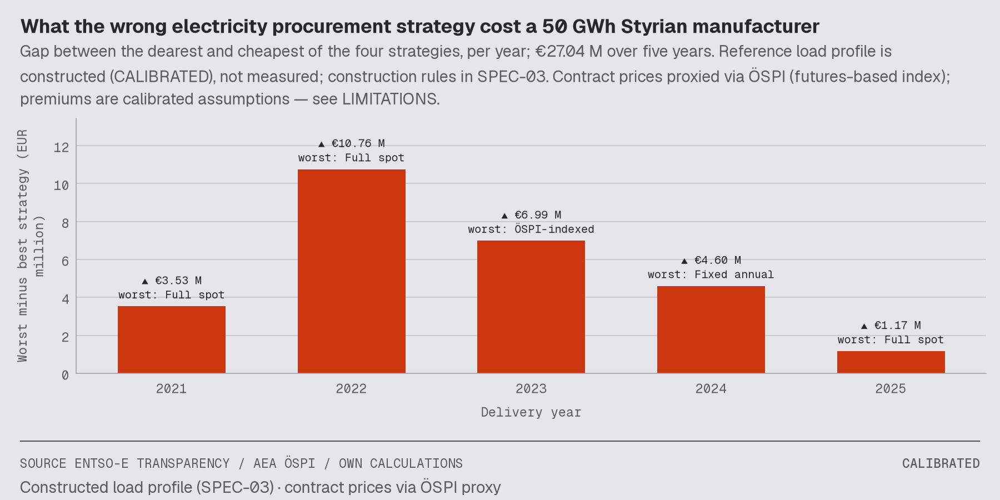
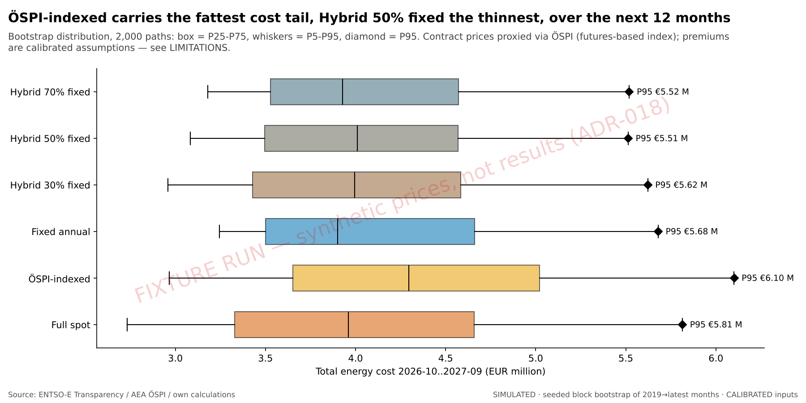
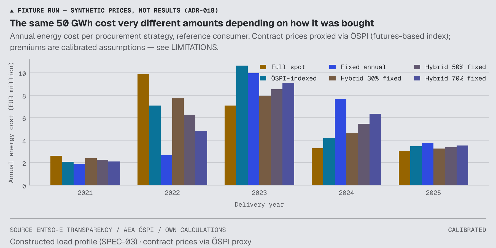

# Energy Procurement Risk Analyzer (EPRA)


[](https://github.com/RafaelBraga-Kribitz/energy-procurement-risk-analyzer/actions/workflows/ci.yml)
[](https://www.python.org/downloads/release/python-3120/)
[](LICENSE)
[](#status)

**Status:** Functional · pipeline complete and tested; first real-data run done; Power BI refresh in Desktop pending

An energy buyer or controller at a manufacturer must choose how to buy electricity. Since the 2021–2023
energy crisis, this choice is a board-level risk in Austria. This project answers two questions for a
**50 GWh Styrian industrial consumer** on the **Austrian day-ahead market**. The market sets next-day
hourly prices, and the prices come from the ENTSO-E Transparency Platform. What did the choice of
strategy cost in 2021–2025? How much cost risk does each strategy carry for the next 12 months? The
tool measures that risk as the 95th-percentile simulated annual cost (exceeded in about 1 year in 20).

**Who decides:** the energy buyer or controller of a 50 GWh Styrian manufacturer. The
[executive summary](reports/EXEC_SUMMARY.md) addresses the CFO or Head of Procurement. The consumer is a
reference case, not a real company.

**What they choose:** how to buy electricity for the next 12 months. The six options are in
[Question](#question).

**The answer:**

<!-- epra:answer:start -->
Buying electricity with the wrong strategy cost the 50 GWh reference consumer €27.04 M (CALIBRATED) over 2021-2025, the sum of each year's gap between the dearest and the cheapest of four strategies. Over the five years **Fixed annual** was the cheapest strategy at €30.17 M (CALIBRATED) in total. For the next 12 months Fixed annual has the lowest expected cost, €4.77 M (SIMULATED), and Hybrid 70% fixed the lowest P95 exposure: €6.44 M (SIMULATED) against €6.61 M (SIMULATED).
<!-- epra:answer:end -->

**The trade-off:** A buyer who minimises expected cost and a buyer who minimises the 95th-percentile
simulated annual cost may choose differently. The results table below shows whether they do. The
[executive summary](reports/EXEC_SUMMARY.md) states the choice for each buyer. The decision depends on how
much cost risk the buyer accepts.

**Main caveat:** The load profile of the plant is constructed, not metered (CALIBRATED). Contract prices
come from the ÖSPI index, a proxy, not from supplier offers. The next-12-month figures resample past
prices (SIMULATED). They are not a price forecast.

<!-- epra:chart:start -->

<!-- epra:chart:end -->
*Chart: the gap between the dearest and the cheapest strategy in each year. The results table below
and the executive summary hold the numbers.*

## What it does

The tool prices four ways to buy electricity on real 2021–2025 prices. It then tests each one on 2,000
simulated 12-month paths. Every number carries one of three tags:

- **VERIFIED:** computed from real data, with no model.
- **CALIBRATED:** a documented assumption anchored to real data.
- **SIMULATED:** the output of a seeded random procedure.

## Why this project exists

Since the 2021–2023 crisis, how a manufacturer buys electricity is a board-level risk, yet many still take
the supplier's offer. This project was meant to show a CFO how much to lock at a fixed price, using the
95th-percentile cost of each strategy. The pre-build evaluation expected €77k of decision value over three
yearly decisions against a central cost of €6,373. That is 12×, so it passes the 4× financial hurdle.
Observed result: Not yet measured; no buyer has used it yet. Details:
[economic evaluation](docs/economic-evaluation.md).

## Question

> **How much did the wrong buying strategy cost a 50 GWh Styrian manufacturer in 2021–2025?
> What is the 95th-percentile simulated annual cost for the next 12 months under each strategy?**

The project compares four strategy types ([simulator specification](docs/SPEC-05_strategy_simulator.md)).
One type, Hybrid, comes in three splits, so the results show six rows.

| Strategy | How the energy is bought |
|---|---|
| Full spot | Every hour at the Austrian day-ahead price |
| ÖSPI-indexed | Monthly price indexed to the Austrian electricity price index (ÖSPI) |
| Fixed annual | One price per year, locked in the second half of the year before |
| Hybrid (30, 50 or 70 percent fixed) | That share at the fixed price, the rest at spot |

The reference consumer, "StyriaMetal GmbH", is a constructed three-shift metal processor. It uses 50,000 MWh
per year. It has reduced weekends, an August maintenance week and a Christmas shutdown
([`config/consumer_profile.yaml`](config/consumer_profile.yaml)).

## Start here

| Audience | Start here |
|---|---|
| Recruiter / hiring manager | The answer above, then [`reports/EXEC_SUMMARY.md`](reports/EXEC_SUMMARY.md) (two pages, CFO view) |
| BI / data analyst | [`sql/`](sql/) headline queries, [`dashboards/`](dashboards/) Power BI project (TMDL + PBIR) and HTML twin, [data-quality report](reports/data_quality/DATA_QUALITY.md) |
| Data engineer | [How it fits together](#how-it-fits-together), [`dbt/`](dbt/), [`.github/workflows/`](.github/workflows/), [Azure path](docs/AZURE_DEPLOYMENT.md) |
| Data scientist | [Market analyses](reports/analytics/), [simulator specification](docs/SPEC-05_strategy_simulator.md), [forward-risk report](reports/strategies/forward_risk_summary.md) |
| Reviewer / auditor | [Numbers used in this report](reports/NUMERIC_SSOT.md), [`LIMITATIONS.md`](LIMITATIONS.md), [decision records](docs/ADR/), [build log](docs/BUILD_LOG.md) |

Skills this project demonstrates:

- **SQL:** dbt models and [headline queries in `sql/`](sql/).
- **Python:** pandas, NumPy and statsmodels.
- **ETL:** retries, caching and validation gates.
- **Data quality:** [Datenqualität report](reports/data_quality/DATA_QUALITY.md).
- **Warehouse:** DuckDB and dbt.
- **Power BI:** [PBIP project](dashboards/).
- **Azure:** [Blob + Azure SQL, Bicep](docs/AZURE_DEPLOYMENT.md). This is a deployment path, not a deployed system.
- **CI/CD:** GitHub Actions.

## Results

The first table shows the cost of each strategy in each past year. The second table shows the simulated cost
of the next 12 months. These terms appear in the second table:

- **P95** is the 95th-percentile simulated annual cost. The simulation exceeds it in about 1 year in 20.
- **CVaR95** is the mean cost of the simulated years above P95. It is higher than P95, so P95 is not a worst case.
- **P5** and **P50** are the 5th percentile and the median.

<!-- epra:results:start -->
**Annual energy cost per strategy, EUR million (CALIBRATED)**

| Strategy | 2021 | 2022 | 2023 | 2024 | 2025 | 2021-2025 |
|---|---:|---:|---:|---:|---:|---:|
| Full spot | 5.70 | 13.84 | 5.51 | 4.34 | 5.22 | 34.61 |
| ÖSPI-indexed | 2.43 | 8.30 | 12.50 | 4.90 | 4.05 | 32.18 |
| Fixed annual | 2.17 | 3.08 | 11.64 | 8.95 | 4.34 | 30.17 |
| Hybrid 30% fixed | 4.64 | 10.61 | 7.35 | 5.72 | 4.95 | 33.28 |
| Hybrid 50% fixed | 3.93 | 8.46 | 8.58 | 6.64 | 4.78 | 32.39 |
| Hybrid 70% fixed | 3.23 | 6.31 | 9.80 | 7.56 | 4.60 | 31.50 |

**Next 12 months (2026-10..2027-09), EUR million (SIMULATED)**

| Strategy | Mean | P5 | P50 | P95 | CVaR95 |
|---|---:|---:|---:|---:|---:|
| Full spot | 5.36 | 3.65 | 5.25 | 7.56 | 8.24 |
| ÖSPI-indexed | 5.15 | 3.47 | 5.03 | 7.16 | 7.88 |
| Fixed annual | 4.77 | 3.75 | 4.51 | 6.61 | 6.96 |
| Hybrid 30% fixed | 5.18 | 3.80 | 5.07 | 6.85 | 7.37 |
| Hybrid 50% fixed | 5.06 | 3.84 | 4.98 | 6.61 | 6.97 |
| Hybrid 70% fixed | 4.95 | 3.88 | 4.82 | 6.44 | 6.80 |

A **cost-minimizing CFO** chooses Fixed annual: the lowest expected 12-month cost, €4.77 M (SIMULATED), with a P95 of €6.61 M (SIMULATED). A **risk-averse CFO** chooses Hybrid 70% fixed: it lowers the P95 by €0.17 M (SIMULATED) and costs €0.18 M (SIMULATED) more in expectation. That premium is the price of the risk reduction.

*Contract prices proxied via ÖSPI (futures-based index); premiums are calibrated assumptions — see LIMITATIONS. Reference load profile is constructed (CALIBRATED), not measured; construction rules in SPEC-03.*
<!-- epra:results:end -->

The [executive summary](reports/EXEC_SUMMARY.md) states the choice for a cost-minimizing buyer and for a
risk-averse buyer. It also lists the cheapest strategy in each year. If the two choices differ, it gives the
euro price of the risk reduction. The results apply to the reference consumer, not to any real
company.



*Chart: the spread of next-12-month cost per strategy over the simulated paths. The diamond marks the
95th-percentile simulated annual cost. A longer box and whisker means more cost risk.*



*Chart: the annual cost of each strategy in each past year. Compare the bars within one year to rank
the strategies for that year.*

Full tables: [strategy comparison](reports/strategies/strategy_annual_summary.md),
[forward risk](reports/strategies/forward_risk_summary.md),
[sensitivities](reports/strategies/sensitivity_matrix.md),
[market analytics](reports/analytics/a1_annual_summary.md).

## Known limits

[`LIMITATIONS.md`](LIMITATIONS.md) holds the full text. The first three limits matter most.

- **The load profile is constructed, not metered** (CALIBRATED). A flat-baseload rerun bounds the effect of the load shape. A metered profile would change the cost levels, not the logic of the comparison.
- **The next-12-month prices are simulated** (SIMULATED). The simulation resamples whole historical months. It cannot produce a crisis worse than the worst crisis in the historical data, so P95 and CVaR95 understate such a tail.
- **The forward view looks one year ahead.** It covers the 12 months after the latest data month. The project does not simulate longer horizons.
- **The ÖSPI index proxies supplier contract prices.** Real offers add margins and terms, and the direction of the bias is unknown. The fixed-price premium is an assumption, and the [sensitivity matrix](reports/strategies/sensitivity_matrix.md) tests it at 0 and 10 EUR/MWh.
- **The project covers energy only.** Grid fees, taxes and levies are out of scope.
- **The project claims no forecast skill.** It backtests strategies on realized prices and stress-tests them by resampling history.

Further charts stay in `reports/` (executive charts, analytics, strategies) and not in this page.

A metered load profile, or supplier offers that do not track the ÖSPI, would change this conclusion. The
sensitivity matrix shows how far the premium and the load shape move it.

## Status

**Status:** Functional

The first real-data run is done. The run found and fixed one bug: ENTSO-E
sends two price series per period, and the parser now keeps the day-ahead series
([decision record](docs/ADR/ADR-023_entsoe-price-classification-position-1.md)). All eight build
milestones are built, tested and green in CI. They cover ingestion, warehouse, load profile, market analytics,
strategy simulator, numbers file, exports, reports, the Power BI project (PBIP) with an HTML twin, and a
monthly refresh workflow. Every number in this README comes from
[Numbers used in this report](reports/NUMERIC_SSOT.md).

Four human steps stay open:

- Open the Power BI project in Desktop, refresh it and take the screenshots.
- Set the repository secret for the monthly refresh.
- Add the ÖSPI months that are newer than the last transcribed month.
- Deploy to Azure (optional).

The [real-data run guide](docs/REAL_DATA_RUN.md) lists the commands.

## Dashboard

Power BI reads the exported CSV files. The report has five pages: headline, market, strategies, risk and
data quality. Every page has a German subtitle and its epistemic tag.

- **[`dashboards/EPRA.pbip`](dashboards/)** is the report as a Power BI Project in text form. It holds a semantic model in TMDL with documented DAX measures. It also holds a report in PBIR with one JSON file per visual. TMDL and PBIR are Microsoft text formats.
- A test checks that every field a visual uses exists in the model. Every file validates against Microsoft schemas ([decision record on the Power BI project format](docs/ADR/ADR-022_powerbi-pbip-and-static-html-twin.md)).
- **HTML twin.** `make dashboard-html` writes the same pages as one static HTML file from the same CSVs. It needs no server and no CDN.

*What does not exist yet:* the Power BI screenshots. No one has opened the report in Power BI Desktop, refreshed
it or taken screenshots. The [open-and-refresh checklist](dashboards/README.md) lists the steps. Until then, the
static charts in [`reports/executive_charts/`](reports/executive_charts/) are the visual deliverable.

## Why this project

Most Austrian mid-size manufacturers still pick a procurement strategy by gut feeling or by whatever the
supplier offers. A euro figure on the gap between strategies turns that choice into a budget decision. A euro
figure on what a lower tail risk costs does the same. A CFO can defend both.

## How it works

1. **Ingest (extract, transform, load).** Python clients fetch the data with retry, cache and validation gates. The gates check hour coverage, the 23-hour and 25-hour days at clock changes, the 15-minute to hourly means and negative prices.
2. **Warehouse.** DuckDB and dbt hold the data. dbt builds and tests SQL tables. The warehouse has staging views, nine tested marts, a schema contract test and a monthly data-quality mart.
3. **Load profile.** A deterministic hourly profile sums to exactly 50,000 MWh per local year. A golden checksum test guards this.
4. **Market analytics.** The reports cover seasonality, the hour-of-day shape, negative hours, the AT–DE price spread and volatility regimes. A hidden Markov model and a GARCH volatility model find the regimes. A crisis sanity gate checks them.
5. **Strategy simulator.** The simulator computes the cost per strategy and year. For the next 12 months it draws 2,000 paths. Each path joins whole historical months (a seeded block bootstrap). It also tests the fixed-price premium, the load shape and the lock window.
6. **Numbers file.** Every published number goes into [Numbers used in this report](reports/NUMERIC_SSOT.md) with a tag. This file is the single source of truth (SSOT). CI fails if the README or the executive summary quotes a number that is not there.

| Tag | Meaning | Applies to |
|---|---|---|
| VERIFIED | Computed from real data, no modelling | Spot prices, negative hours, AT–DE spread |
| CALIBRATED | Documented assumptions anchored to real data | Load profile, ÖSPI → EUR/MWh translation, strategy costs |
| SIMULATED | Seeded stochastic procedure | Next-12-month mean, P95, CVaR95 (mean cost of the worst 5 percent of paths) |

The project makes no price forecast. It backtests strategies on realized 2021–2025 prices. It stress-tests them
by resampling history.

### Legend: strategy keys in files

Files and the numbers file use short keys for the strategies. This table gives the plain name of each key.

| Key | Plain name |
|---|---|
| S1 | Full spot |
| S2 | ÖSPI-indexed |
| S3 | Fixed annual (full forward hedge) |
| S4_30, S4_50, S4_70 | Hybrid 30, 50 and 70 percent fixed (for example 70 percent forward, 30 percent spot) |

## Data

| Source | What | Tag |
|---|---|---|
| [ENTSO-E Transparency Platform](https://transparency.entsoe.eu) | AT and DE-LU day-ahead prices (hourly and 15-minute), AT load and generation | VERIFIED |
| [Austrian Energy Agency: ÖSPI](https://www.energyagency.at/fakten/strompreisindex) | Monthly wholesale index, base and peak, double-entry transcription | VERIFIED |
| [GeoSphere Austria Data Hub](https://data.hub.geosphere.at) | Daily mean temperature, Graz | VERIFIED |
| `holidays` package | Austrian and Styrian public holidays | VERIFIED |
| Constructed load profile | StyriaMetal hourly load ([load profile specification](docs/SPEC-03_consumer_load_profile.md)) | CALIBRATED |

The data window runs from 2019-01 to the latest complete month. The project never publishes a synthetic market
price. Gaps stay NULL, and the [data-quality report](reports/data_quality/DATA_QUALITY.md) lists them.

## How it fits together


## Repository structure

| Path | Responsibility |
|---|---|
| `src/epra/ingest/` | ENTSO-E, GeoSphere, ÖSPI, calendar, validation gates |
| `dbt/` | Staging and marts on DuckDB, schema contract, data tests |
| `src/epra/consumer/` | Deterministic load profile |
| `src/epra/analytics/` | Market analytics |
| `src/epra/strategies/` | SQL inputs, strategy engine, retrospective, forward risk |
| `src/epra/report/` | Charts, data-quality report, executive summary |
| `src/epra/cloud/` | Publish targets: local (default) and Azure |
| `sql/` | Headline answers as plain SQL, tested against the Python engine |
| `dashboards/` | Power BI project (PBIP), build kit, HTML twin generator target |
| `infra/azure/` | Bicep for the optional Azure path |
| `reports/` | Numbers file, executive summary, analytics, strategies, data quality |
| `docs/` | Project charter, eight specifications, decision records, build log |

## Stack

| Technology | Role |
|---|---|
| Python 3.12 + uv | Runtime, committed lockfile |
| DuckDB + dbt | Warehouse, SQL transformations, data tests |
| pandas, NumPy, statsmodels, hmmlearn, arch | Analytics and simulation |
| matplotlib | Charts (one shared style module) |
| Power BI (PBIP: TMDL + PBIR) | Interactive dashboard on the exported CSVs, plus a static HTML twin |
| Azure Blob Storage + Azure SQL (optional) | Cloud copy of raw data and results |
| GitHub Actions | Lint, tests, fixture pipeline run, numbers check, monthly refresh |

Quality tools: ruff (linter) and strict mypy (type checker) check the code. pytest runs with at least 80 % line
coverage. Golden tests guard the load profile and the strategy engine. A monthly scheduled refresh opens a pull
request. Governance is light: epistemic tags, append-only decision records, the CI-checked numbers file and
`LIMITATIONS.md`.

## Reproduce

```bash
git clone https://github.com/RafaelBraga-Kribitz/energy-procurement-risk-analyzer.git
cd energy-procurement-risk-analyzer
cp .env.example .env          # ENTSOE_API_TOKEN=... (free registration at ENTSO-E)
make setup                    # exact versions from uv.lock
make backfill                 # ENTSO-E prices, load, generation 2019 → last complete month
make geosphere                # Graz daily temperature
make calendar                 # hourly calendar with Austrian / Styrian holidays
make validate-ingest          # ingestion gates → reports/ingestion/
make all                      # dbt → profile → analytics → simulator → numbers file → exports → reports
make publish TARGET=azure     # optional, see docs/AZURE_DEPLOYMENT.md
```

No token? Run the same pipeline offline on the synthetic fixture:
`uv run python scripts/bootstrap_fixture_warehouse.py --force && make all`. The pipeline then stamps every
output FIXTURE. Two runs on the same data give byte-identical results, because the HMM restarts and the
bootstrap are seeded. On the fixture, the result blocks in this README hold a notice and no numbers.

## Kurzfassung auf Deutsch

Dieses Projekt beantwortet eine Frage aus dem Energieeinkauf: Was hat die Wahl der
Beschaffungsstrategie (Spot, ÖSPI-indexiert, Fixpreis, Mischung) einen steirischen
Industriebetrieb mit 50 GWh Jahresverbrauch in den Jahren 2021–2025 gekostet, und wie
hoch ist das Kostenrisiko (95. Perzentil der simulierten Jahreskosten, in etwa einem von 20 Jahren überschritten) für die nächsten 12 Monate? Grundlage sind reale
Day-Ahead-Preise für Österreich (ENTSO-E), der Strompreisindex ÖSPI und Wetterdaten
aus Graz. Das Lastprofil ist konstruiert, nicht gemessen. Alle Kennzahlen stehen mit
Herkunftskennzeichnung in `reports/NUMERIC_SSOT.md`; Datenqualität und Reporting sind
automatisiert; das Dashboard liegt als Power-BI-Projekt (PBIP) und als statische HTML-Fassung vor.

## Future work

Outside the project charter by design, one line each:

- Measured interval-metered (RLM) load data from a real plant instead of the constructed profile.
- Grid fees, taxes and levies for a full electricity-bill view.

## License

MIT. See [LICENSE](LICENSE).

## Author

<table>
  <tr>
    <td width="110">
      
    </td>
    <td>
      <strong>Rafael Braga-Kribitz</strong><br />
      Graz area, Austria · Portfolio project, 2026<br />
      <a href="https://www.linkedin.com/in/rafaelbragakribitz/">LinkedIn</a>
      ·
      <a href="mailto:rafaelbragakribitz@gmail.com">rafaelbragakribitz@gmail.com</a>
    </td>
  </tr>
</table>
