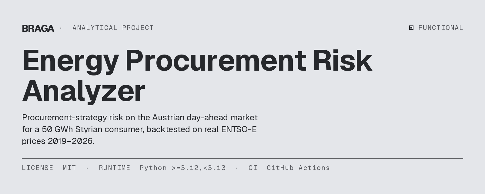
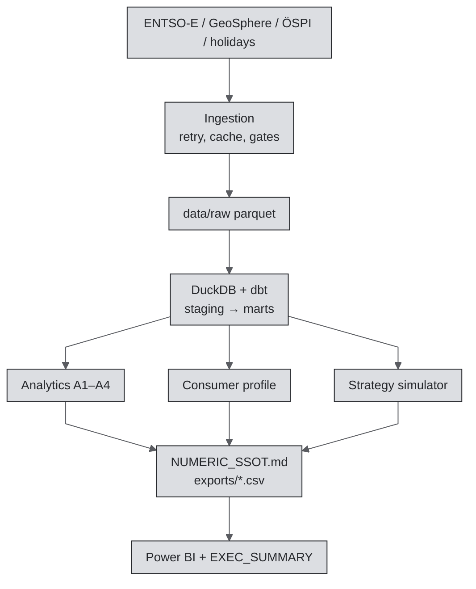

# Energy Procurement Risk Analyzer (EPRA)



[](https://github.com/RafaelBraga-Kribitz/energy-procurement-risk-analyzer/actions/workflows/ci.yml)
[](https://www.python.org/downloads/release/python-3120/)
[](LICENSE)
[](#project-status)

**Status:** Functional · pipeline complete and tested; real-data run pending

Since the 2021–2023 energy crisis, how a manufacturer buys electricity is a board-level
risk in Austria. What did the choice of procurement strategy cost a **50 GWh Styrian
industrial consumer** on the **Austrian day-ahead market** (prices from the ENTSO-E
Transparency Platform) in 2021–2025, and how much cost risk does each strategy carry for
the next 12 months?

<!-- epra:answer:start -->
> **Results pending the first real-data run.** The pipeline is complete and tested end to end on a synthetic CI fixture (ADR-018); fixture numbers are never shown here as results. Running `make backfill && make all` with an ENTSO-E token fills this section from `reports/NUMERIC_SSOT.md`.
<!-- epra:answer:end -->

<!-- epra:chart:start -->
*The headline chart (what the wrong strategy cost per year) is embedded here after the first real-data run. A watermarked [pipeline preview on synthetic fixture data](reports/executive_charts/01_wrong_strategy_cost.png) shows its layout; its figures are not results.*
<!-- epra:chart:end -->

**Skills demonstrated:** SQL (dbt models, [headline queries in `sql/`](sql/)) · Python
(pandas, NumPy, statsmodels) · ETL with retries, caching and validation gates ·
data quality reporting ([Datenqualität](reports/data_quality/DATA_QUALITY.md)) · DuckDB + dbt
warehouse · Power BI ([build kit](dashboards/)) · Azure-ready deployment path
([Blob + Azure SQL, Bicep](docs/AZURE_DEPLOYMENT.md)) · CI/CD on GitHub Actions.

**Run it:**

```bash
git clone https://github.com/RafaelBraga-Kribitz/energy-procurement-risk-analyzer.git
cd energy-procurement-risk-analyzer
cp .env.example .env          # add ENTSOE_API_TOKEN (free, transparency.entsoe.eu)
make setup && make backfill && make geosphere && make calendar
make all                      # warehouse → profile → analytics → simulator → SSOT → exports → reports
```

No token? `uv run python scripts/bootstrap_fixture_warehouse.py --force && make all`
runs the same pipeline offline on the synthetic fixture (every output is then stamped
FIXTURE).

## Project status

**Status:** Functional

**Real-data results do not exist yet.** Milestones M0–M7 are built, tested and
green in CI: ingestion, warehouse, load profile, market analytics, strategy simulator,
SSOT, exports, reports, Power BI build kit, monthly refresh workflow. The build
environment had no ENTSO-E token, so every committed result artifact comes from the
synthetic fixture (ADR-018) and carries a FIXTURE banner or watermark. The first
`make all` on real data replaces them; the README answer above is rendered from the SSOT
at that moment ([real-data run guide](docs/REAL_DATA_RUN.md): `make real-run`). Open human steps: the real-data run, the Power BI `.pbix` and
its screenshots, and an optional Azure deployment.

## Explore this project

| Audience | Start here |
|---|---|
| Recruiter / hiring manager | The answer above, then [`reports/EXEC_SUMMARY.md`](reports/EXEC_SUMMARY.md) (two pages, CFO view) |
| BI / data analyst | [`sql/`](sql/) headline queries, [`dashboards/`](dashboards/) Power BI build kit, [data-quality report](reports/data_quality/DATA_QUALITY.md) |
| Data engineer | [Architecture](#architecture), [`dbt/`](dbt/), [`.github/workflows/`](.github/workflows/), [Azure path](docs/AZURE_DEPLOYMENT.md) |
| Data scientist | [Analytics A1–A4](reports/analytics/), [simulator specs](docs/SPEC-05_strategy_simulator.md), [forward-risk report](reports/strategies/forward_risk_summary.md) |
| Reviewer / auditor | [`reports/NUMERIC_SSOT.md`](reports/NUMERIC_SSOT.md), [`LIMITATIONS.md`](LIMITATIONS.md), [ADRs](docs/ADR/), [build log](docs/BUILD_LOG.md) |

## Question

> **How much did buying electricity the wrong way cost a 50 GWh/year Styrian
> manufacturer in 2021–2025, and what is the 95th-percentile (P95) cost exposure for
> the next 12 months under each procurement strategy?**

Four strategies, no more ([SPEC-05](docs/SPEC-05_strategy_simulator.md)):

| Strategy | How the energy is bought |
|---|---|
| Full spot | Every hour at the Austrian day-ahead price |
| ÖSPI-indexed | Monthly price indexed to the Austrian electricity price index (ÖSPI) |
| Fixed annual | One price per year, locked in the second half of the year before |
| Hybrid (30, 50 or 70 percent fixed) | That share at the fixed price, the rest at spot |

The reference consumer, "StyriaMetal GmbH", is a constructed three-shift metal processor
with 50,000 MWh per year, reduced weekends, an August maintenance week and a Christmas
shutdown ([`config/consumer_profile.yaml`](config/consumer_profile.yaml)).

## Data

| Source | What | Tag |
|---|---|---|
| [ENTSO-E Transparency Platform](https://transparency.entsoe.eu) | AT and DE-LU day-ahead prices (hourly and 15-minute), AT load and generation | VERIFIED |
| [Austrian Energy Agency: ÖSPI](https://www.energyagency.at/fakten/strompreisindex) | Monthly wholesale index, base and peak, double-entry transcription | VERIFIED |
| [GeoSphere Austria Data Hub](https://data.hub.geosphere.at) | Daily mean temperature, Graz | VERIFIED |
| `holidays` package | Austrian and Styrian public holidays | VERIFIED |
| Constructed load profile | StyriaMetal hourly load ([SPEC-03](docs/SPEC-03_consumer_load_profile.md)) | CALIBRATED |

Window: 2019-01 → latest complete month. No synthetic market price is ever published:
gaps stay NULL and are reported in the [data-quality report](reports/data_quality/DATA_QUALITY.md).

## Method

1. **Ingest (extract, transform, load).** Python clients with retry, cache and validation gates (hour
   coverage, DST 23/25-hour days, 15-minute → hourly means, negative prices).
2. **Warehouse.** DuckDB + dbt: staging views, nine tested marts, a schema contract test,
   and a monthly data-quality mart.
3. **Load profile.** Deterministic hourly profile, exactly 50,000 MWh per local year
   (golden checksum test).
4. **Market analytics.** Seasonality, hour-of-day shape, negative hours, AT–DE spread,
   volatility regimes (hidden Markov model and a GARCH volatility model) with a crisis
   sanity gate.
5. **Strategy simulator.** Retrospective cost per strategy and year; next-12-month cost
   distribution from a seeded block bootstrap of whole historical months (2,000 paths);
   sensitivities for the fixed-price premium, the load shape and the lock window.
6. **Single source of truth (SSOT).** Every published number is generated into
   [`reports/NUMERIC_SSOT.md`](reports/NUMERIC_SSOT.md) with an epistemic tag; CI fails
   if README or executive summary quotes a number that is not there.

| Tag | Meaning | Applies to |
|---|---|---|
| VERIFIED | Computed from real data, no modelling | Spot prices, negative hours, AT–DE spread |
| CALIBRATED | Documented assumptions anchored to real data | Load profile, ÖSPI → EUR/MWh translation, strategy costs |
| SIMULATED | Seeded stochastic procedure | Next-12-month mean, P95, CVaR95 (mean cost of the worst 5 percent of paths) |

No price forecast is made: strategies are backtested on realized 2021–2025 prices and
stress-tested by resampling history.

## Results

<!-- epra:results:start -->
> **Results pending the first real-data run.** The pipeline is complete and tested end to end on a synthetic CI fixture (ADR-018); fixture numbers are never shown here as results. Running `make backfill && make all` with an ENTSO-E token fills this section from `reports/NUMERIC_SSOT.md`.
<!-- epra:results:end -->

Full tables: [strategy comparison](reports/strategies/strategy_annual_summary.md),
[forward risk](reports/strategies/forward_risk_summary.md),
[sensitivities](reports/strategies/sensitivity_matrix.md),
[market analytics](reports/analytics/a1_annual_summary.md).

## Dashboard

Power BI on the exported CSVs, five pages: decision, market, strategies, risk, data
quality. The [build kit](dashboards/README.md) contains the star schema, Power Query
steps, every DAX measure ([`measures.dax`](dashboards/measures.dax)) and the theme. The
`.pbix` and its screenshots are built by hand after the real-data run; until then the
static charts in [`reports/executive_charts/`](reports/executive_charts/) are the visual
deliverable.

## Limitations

[`LIMITATIONS.md`](LIMITATIONS.md) is the full text. In short:

- The load profile is **constructed, not metered** (CALIBRATED); a flat-baseload rerun
  bounds the shape effect.
- **ÖSPI proxies supplier contract prices**; real offers add margins and terms, with an
  unknown bias direction. The fixed-price premium is an assumption with a 0 / 10
  sensitivity.
- The bootstrap **cannot produce a crisis worse than 2022**; P95 understates such a tail.
- **Energy only:** grid fees, taxes and levies are out of scope.
- **No forecast skill** is claimed anywhere.

Charts stay in `reports/` (executive charts, analytics, strategies) rather than in this
page until the real-data run: the committed ones are watermarked fixture previews.

A metered load profile, or supplier offers that do not track the ÖSPI, would change this
conclusion; the sensitivity matrix shows how far the premium and the load shape move it.

## Why this project

Most Austrian mid-size manufacturers still pick a procurement strategy by gut feeling or
by whatever the supplier offers. Putting a euro figure on the gap between strategies, and
on what a lower worst case costs, turns that choice into a budget decision a CFO can
defend.

## Decision

The [executive summary](reports/EXEC_SUMMARY.md) states what a cost-minimizing and a
risk-averse CFO would choose for the next 12 months and the price of the risk reduction
in euros, for the reference consumer, not for any real company.

## Architecture



## Repository structure

| Path | Responsibility |
|---|---|
| `src/epra/ingest/` | ENTSO-E, GeoSphere, ÖSPI, calendar, validation gates |
| `dbt/` | Staging and marts on DuckDB, schema contract, data tests |
| `src/epra/consumer/` | Deterministic load profile |
| `src/epra/analytics/` | Market analytics A1–A4 |
| `src/epra/strategies/` | SQL inputs, strategy engine, retrospective, forward risk |
| `src/epra/report/` | Charts, data-quality report, executive summary |
| `src/epra/cloud/` | Publish targets: local (default) and Azure |
| `sql/` | Headline answers as plain SQL, tested against the Python engine |
| `dashboards/` | Power BI build kit |
| `infra/azure/` | Bicep for the optional Azure path |
| `reports/` | SSOT, executive summary, analytics, strategies, data quality |
| `docs/` | Charter specs SPEC-01…08, ADRs, build log |

## Stack

| Technology | Role |
|---|---|
| Python 3.12 + uv | Runtime, committed lockfile |
| DuckDB + dbt | Warehouse, SQL transformations, data tests |
| pandas, NumPy, statsmodels, hmmlearn, arch | Analytics and simulation |
| matplotlib | Charts (one shared style module) |
| Power BI | Interactive dashboard on the exported CSVs |
| Azure Blob Storage + Azure SQL (optional) | Cloud copy of raw data and results |
| GitHub Actions | Lint, tests, fixture pipeline run, SSOT check, monthly refresh |

Quality: ruff and strict mypy, pytest with at least 80 % line coverage, golden tests
for the load profile and the strategy engine, and a monthly scheduled refresh that opens
a pull request. Governance is deliberately light: epistemic tags, append-only ADRs, the
CI-gated SSOT and `LIMITATIONS.md`.

## Reproduce

```bash
git clone https://github.com/RafaelBraga-Kribitz/energy-procurement-risk-analyzer.git
cd energy-procurement-risk-analyzer
cp .env.example .env          # ENTSOE_API_TOKEN=... (free registration at ENTSO-E)
make setup                    # exact versions from uv.lock
make backfill                 # ENTSO-E prices, load, generation 2019 → last complete month
make geosphere                # Graz daily temperature
make calendar                 # hourly calendar with Austrian / Styrian holidays
make validate-ingest          # ingestion gates → reports/ingestion/
make all                      # dbt → profile → analytics → simulator → SSOT → exports → reports
make publish TARGET=azure     # optional, see docs/AZURE_DEPLOYMENT.md
```

Without a token the same pipeline runs offline on the synthetic fixture:
`uv run python scripts/bootstrap_fixture_warehouse.py --force && make all`. Two runs on
the same data produce byte-identical results (seeded HMM restarts and bootstrap).

## Kurzfassung auf Deutsch

Dieses Projekt beantwortet eine Frage aus dem Energieeinkauf: Was hat die Wahl der
Beschaffungsstrategie (Spot, ÖSPI-indexiert, Fixpreis, Mischung) einen steirischen
Industriebetrieb mit 50 GWh Jahresverbrauch in den Jahren 2021–2025 gekostet, und wie
hoch ist das Kostenrisiko (P95) für die nächsten 12 Monate? Grundlage sind reale
Day-Ahead-Preise für Österreich (ENTSO-E), der Strompreisindex ÖSPI und Wetterdaten
aus Graz. Das Lastprofil ist konstruiert, nicht gemessen. Alle Kennzahlen stehen mit
Herkunftskennzeichnung in `reports/NUMERIC_SSOT.md`; Datenqualität und Reporting sind
automatisiert, das Dashboard wird in Power BI gebaut.

## Future work

Outside the Charter scope by design (A-3), one line each:

- Measured interval-metered (RLM) load data from a real plant instead of the constructed profile.
- Grid fees, taxes and levies for a full electricity-bill view.

## License

MIT. See [LICENSE](LICENSE).

## Author

<table>
  <tr>
    <td width="110">
      
    </td>
    <td>
      <strong>Rafael Braga-Kribitz</strong><br />
      Graz area, Austria · Portfolio project, 2026<br />
      <a href="https://www.linkedin.com/in/rafaelbragakribitz/">LinkedIn</a>
      ·
      <a href="mailto:rafaelbragakribitz@gmail.com">rafaelbragakribitz@gmail.com</a>
    </td>
  </tr>
</table>
