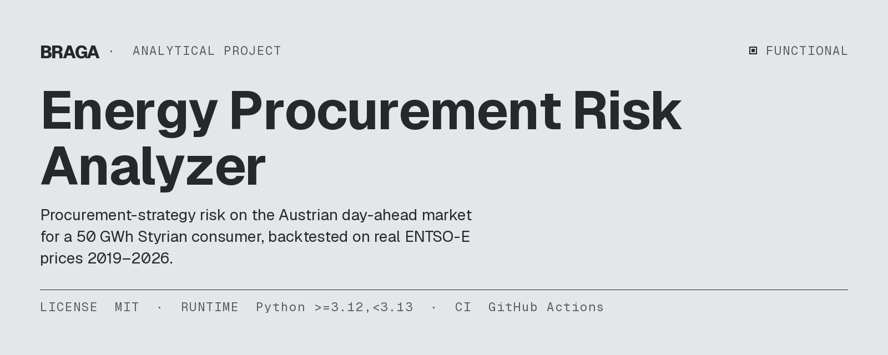
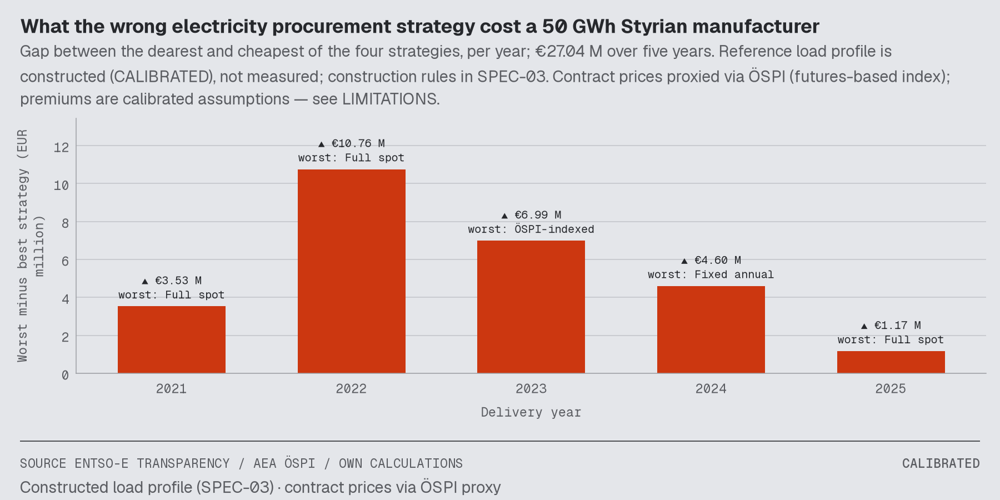
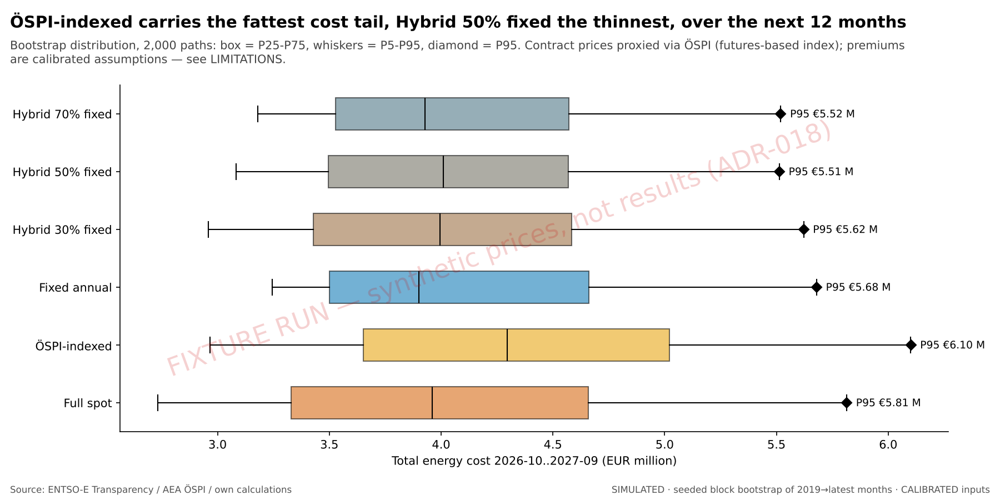
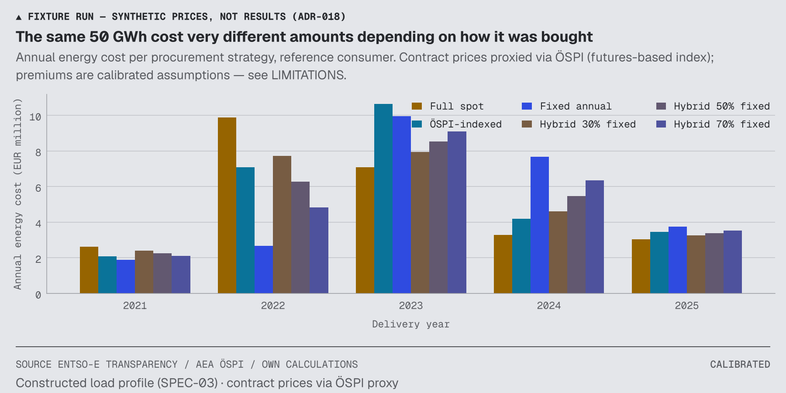
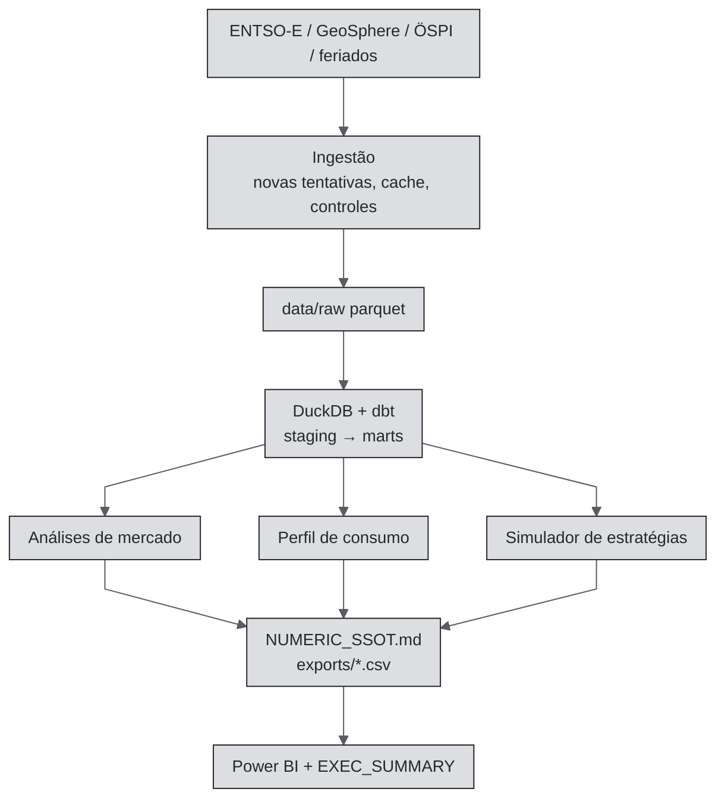

[🇧🇷 PT-BR](README.pt-BR.md) · [🇬🇧 EN-UK](README.md) · [🇦🇹 DE-AT](README.de-AT.md)

# Analisador de risco de compra de energia (EPRA)



[](https://github.com/RafaelBraga-Kribitz/energy-procurement-risk-analyzer/actions/workflows/ci.yml)
[](https://www.python.org/downloads/release/python-3120/)
[](LICENSE)
[](#status)

**Status:** Funcional · pipeline concluída e testada; primeira execução com dados reais feita; atualização do Power BI Desktop pendente

Um comprador de energia ou controller de uma indústria precisa escolher como comprar eletricidade. Desde a crise energética de 2021–2023, essa escolha é um risco de nível executivo na Áustria. Este projeto responde a duas perguntas para um **consumidor industrial de 50 GWh na Estíria**, no **mercado austríaco day-ahead**. Esse mercado define preços horários para o dia seguinte, e os preços vêm da Plataforma de Transparência da ENTSO-E. Quanto custou a escolha de cada estratégia entre 2021 e 2025? Qual é o risco de custo de cada estratégia nos próximos 12 meses? O indicador é o custo anual simulado no percentil 95 (P95), ultrapassado em cerca de 1 ano a cada 20.

**Quem decide:** o comprador ou controller de energia de um fabricante estírio de 50 GWh. A [síntese executiva](reports/EXEC_SUMMARY.md) é dirigida ao CFO ou responsável por Compras. O consumidor é um caso de referência, não uma empresa real.

**O que escolhe:** como comprar eletricidade nos próximos 12 meses. As seis opções estão em [Pergunta](#pergunta).

**Resposta:**

<!-- epra:answer:start -->
Comprar eletricidade com a estratégia errada custou ao consumidor de referência de 50 GWh €27,04 milhões (CALIBRADO) entre 2021 e 2025: a soma, em cada ano, da diferença entre a mais cara e a mais barata de quatro estratégias. No total dos cinco anos, **Fixa anual** foi a mais barata, com €30,17 milhões (CALIBRADO). Para os próximos 12 meses, Fixa anual tem o menor custo esperado, €4,77 milhões (SIMULADO), e Híbrida com 70% fixo tem a menor exposição P95: €6,44 milhões (SIMULADO), contra €6,61 milhões (SIMULADO).
<!-- epra:answer:end -->

**Trade-off:** um comprador que minimiza o custo esperado pode escolher uma estratégia diferente de quem minimiza o custo anual simulado no percentil 95. A tabela de resultados abaixo mostra se isso acontece. A [síntese executiva](reports/EXEC_SUMMARY.md) apresenta a escolha para cada perfil de comprador. A decisão depende de quanto risco de custo o comprador aceita.

**Principal ressalva:** o perfil de carga da unidade é construído, não medido (CALIBRADO). Os preços contratuais usam o índice ÖSPI como proxy, não ofertas de fornecedores. Os valores para os próximos 12 meses reamostram preços passados (SIMULADO); não são uma previsão de preços.

<!-- epra:chart:start -->

<!-- epra:chart:end -->
*Gráfico: a diferença entre a estratégia mais cara e a mais barata em cada ano. A tabela de resultados abaixo e a síntese executiva apresentam os valores.*

## O que faz

A ferramenta calcula o custo de quatro formas de comprar eletricidade usando preços reais de 2021 a 2025. Em seguida, testa cada opção em 2.000 trajetórias simuladas de 12 meses. Cada número recebe uma de três classificações:

- **VERIFICADO:** calculado com dados reais, sem modelo.
- **CALIBRADO:** hipótese documentada e ancorada em dados reais.
- **SIMULADO:** resultado de um procedimento aleatório com seed fixa.

## Por que este projeto existe

Desde a crise de 2021–2023, a forma como uma indústria compra eletricidade é um risco de nível executivo, mas muitas ainda aceitam a oferta do fornecedor. Este projeto deveria mostrar a um CFO quanto fixar em preço, usando o custo no percentil 95 de cada estratégia. A avaliação anterior à construção estimou €77 mil de valor decisório ao longo de três decisões anuais, diante de um custo central de €6.373. Isso equivale a 12× e supera o requisito financeiro de 4×. Resultado observado: ainda não medido; nenhum comprador usou a ferramenta. Detalhes: [avaliação econômica](docs/economic-evaluation.md).

## Pergunta

> **Quanto custou a um fabricante estírio de 50 GWh escolher a estratégia errada entre 2021 e 2025?
> Qual é o custo anual simulado no percentil 95 para os próximos 12 meses em cada estratégia?**

O projeto compara quatro tipos de estratégia ([especificação do simulador](docs/SPEC-05_strategy_simulator.md)).
Uma delas, Híbrida, tem três proporções; por isso, os resultados mostram seis linhas.

| Estratégia | Como a energia é comprada |
|---|---|
| Totalmente spot | A cada hora, ao preço austríaco day-ahead |
| Indexada ao ÖSPI | Preço mensal indexado ao Índice Austríaco de Preços de Eletricidade (ÖSPI) |
| Fixa anual | Um preço por ano, contratado no segundo semestre do ano anterior |
| Híbrida (30%, 50% ou 70% fixa) | Essa proporção ao preço fixo, o restante no spot |

O consumidor de referência, “StyriaMetal GmbH”, é uma processadora de metais construída para o modelo, com três turnos. Consome 50.000 MWh por ano. O perfil inclui redução nos fins de semana, uma semana de manutenção em agosto e parada no Natal ([`config/consumer_profile.yaml`](config/consumer_profile.yaml)).

## Comece por aqui

| Público | Comece por |
|---|---|
| Recrutador / gestor de contratação | A resposta acima e depois [`reports/EXEC_SUMMARY.md`](reports/EXEC_SUMMARY.md) (duas páginas, visão do CFO) |
| Analista de BI / dados | [consultas principais em `sql/`](sql/), projeto Power BI em [`dashboards/`](dashboards/) (TMDL + PBIR) e sua versão HTML, [relatório de qualidade dos dados](reports/data_quality/DATA_QUALITY.md) |
| Engenheiro de dados | [Como as partes se conectam](#como-as-partes-se-conectam), [`dbt/`](dbt/), [`.github/workflows/`](.github/workflows/), [caminho Azure](docs/AZURE_DEPLOYMENT.md) |
| Cientista de dados | [análises de mercado](reports/analytics/), [especificação do simulador](docs/SPEC-05_strategy_simulator.md), [relatório de risco futuro](reports/strategies/forward_risk_summary.md) |
| Revisor / auditor | [Números deste relatório](reports/NUMERIC_SSOT.md), [`LIMITATIONS.md`](LIMITATIONS.md), [registros de decisão](docs/ADR/), [registro de construção](docs/BUILD_LOG.md) |

Competências demonstradas pelo projeto:

- **SQL:** modelos dbt e [consultas principais em `sql/`](sql/).
- **Python:** pandas, NumPy e statsmodels.
- **ETL:** novas tentativas, cache e controles de validação.
- **Qualidade de dados:** [relatório de qualidade dos dados](reports/data_quality/DATA_QUALITY.md).
- **Data warehouse:** DuckDB e dbt.
- **Power BI:** [projeto PBIP](dashboards/).
- **Azure:** [Blob + Azure SQL, Bicep](docs/AZURE_DEPLOYMENT.md). Este é um caminho de implantação, não um sistema implantado.
- **CI/CD:** GitHub Actions.

## Resultados

A primeira tabela mostra o custo de cada estratégia em cada ano passado. A segunda mostra o custo simulado
dos próximos 12 meses. Estes termos aparecem na segunda tabela:

- **P95** é o custo anual simulado no percentil 95. A simulação o supera em cerca de 1 ano a cada 20.
- **CVaR95** é o custo médio dos anos simulados acima do P95. É maior que o P95; portanto, o P95 não é o pior caso.
- **P5** e **P50** são o 5º percentil e a mediana.

<!-- epra:results:start -->
**Custo anual de energia por estratégia, milhões de EUR (CALIBRADO)**

| Estratégia | 2021 | 2022 | 2023 | 2024 | 2025 | 2021-2025 |
|---|---:|---:|---:|---:|---:|---:|
| Totalmente spot | 5.70 | 13.84 | 5.51 | 4.34 | 5.22 | 34.61 |
| Indexada ao ÖSPI | 2.43 | 8.30 | 12.50 | 4.90 | 4.05 | 32.18 |
| Fixa anual | 2.17 | 3.08 | 11.64 | 8.95 | 4.34 | 30.17 |
| Híbrida 30% fixa | 4.64 | 10.61 | 7.35 | 5.72 | 4.95 | 33.28 |
| Híbrida 50% fixa | 3.93 | 8.46 | 8.58 | 6.64 | 4.78 | 32.39 |
| Híbrida 70% fixa | 3.23 | 6.31 | 9.80 | 7.56 | 4.60 | 31.50 |

**Próximos 12 meses (2026-10..2027-09), milhões de EUR (SIMULADO)**

| Estratégia | Média | P5 | P50 | P95 | CVaR95 |
|---|---:|---:|---:|---:|---:|
| Totalmente spot | 5.36 | 3.65 | 5.25 | 7.56 | 8.24 |
| Indexada ao ÖSPI | 5.15 | 3.47 | 5.03 | 7.16 | 7.88 |
| Fixa anual | 4.77 | 3.75 | 4.51 | 6.61 | 6.96 |
| Híbrida 30% fixa | 5.18 | 3.80 | 5.07 | 6.85 | 7.37 |
| Híbrida 50% fixa | 5.06 | 3.84 | 4.98 | 6.61 | 6.97 |
| Híbrida 70% fixa | 4.95 | 3.88 | 4.82 | 6.44 | 6.80 |

Um **CFO que minimiza custos** escolhe Fixa anual: o menor custo esperado em 12 meses, €4,77 milhões (SIMULADO), com P95 de €6,61 milhões (SIMULADO). Um **CFO avesso a risco** escolhe Híbrida 70% fixa: reduz o P95 em €0,17 milhão (SIMULADO) e custa €0,18 milhão (SIMULADO) a mais em expectativa. Esse adicional é o preço da redução de risco.

*Preços de contrato aproximados pelo ÖSPI (índice baseado em futuros); os prêmios são hipóteses calibradas — consulte LIMITATIONS. O perfil de carga de referência é construído (CALIBRADO), não medido; as regras de construção estão na SPEC-03.*
<!-- epra:results:end -->

A [síntese executiva](reports/EXEC_SUMMARY.md) apresenta a escolha para o comprador que minimiza custos e para o comprador avesso a risco. Também lista a estratégia mais barata em cada ano. Se as escolhas diferirem, informa o custo em euros da redução de risco. Os resultados se aplicam ao consumidor de referência, não a qualquer empresa real.



*Gráfico: distribuição dos custos nos próximos 12 meses por estratégia ao longo das trajetórias simuladas. O losango marca o custo anual simulado no percentil 95. Um box e bigodes mais longos indicam maior risco de custo.*



*Gráfico: custo anual de cada estratégia nos anos passados. Compare as barras dentro de um mesmo ano para ordenar as estratégias daquele ano.*

Tabelas completas: [comparação de estratégias](reports/strategies/strategy_annual_summary.md),
[risco futuro](reports/strategies/forward_risk_summary.md),
[sensibilidades](reports/strategies/sensitivity_matrix.md),
[análises de mercado](reports/analytics/a1_annual_summary.md).

## Limitações conhecidas

[`LIMITATIONS.md`](LIMITATIONS.md) contém o texto completo. As três primeiras limitações são as mais importantes.

- **O perfil de carga é construído, não medido** (CALIBRADO). Uma nova execução com carga-base uniforme delimita o efeito do formato da carga. Um perfil medido alteraria os níveis de custo, não a lógica da comparação.
- **Os preços dos próximos 12 meses são simulados** (SIMULADO). A simulação reamostra meses históricos inteiros. Ela não pode produzir uma crise pior que a pior crise dos dados históricos; portanto, P95 e CVaR95 subestimam uma cauda desse tipo.
- **A perspectiva futura cobre um ano.** Abrange os 12 meses posteriores ao mês de dados mais recente. O projeto não simula horizontes mais longos.
- **O índice ÖSPI aproxima os preços de contratos de fornecedores.** Ofertas reais incluem margens e condições, e a direção do viés é desconhecida. O prêmio de preço fixo é uma hipótese; a [matriz de sensibilidade](reports/strategies/sensitivity_matrix.md) testa 0 e 10 EUR/MWh.
- **O projeto cobre apenas energia.** Tarifas de rede, impostos e encargos não fazem parte do escopo.
- **O projeto não alega capacidade de previsão.** Ele testa estratégias com preços realizados e as submete a testes de estresse reamostrando o histórico.

Os demais gráficos ficam em `reports/` (gráficos executivos, análises e estratégias), não nesta página.

Um perfil de carga medido ou ofertas de fornecedores que não acompanhem o ÖSPI mudariam esta conclusão. A matriz de sensibilidade mostra quanto o prêmio e o formato da carga a alteram.

## Status

**Status:** Funcional

A primeira execução com dados reais foi concluída. Ela encontrou e corrigiu um bug: a ENTSO-E envia duas séries de preços por período, e o parser agora mantém a série day-ahead
([registro de decisão](docs/ADR/ADR-023_entsoe-price-classification-position-1.md)). Todos os oito marcos de construção foram implementados, testados e aprovados no CI. Eles abrangem ingestão, data warehouse, perfil de carga, análises de mercado, simulador de estratégias, arquivo de números, exportações, relatórios, projeto Power BI (PBIP) com versão HTML equivalente e fluxo de atualização mensal. Cada número deste README vem de
[Números usados neste relatório](reports/NUMERIC_SSOT.md).

Quatro etapas humanas continuam pendentes:

- Abrir o projeto Power BI no Desktop, atualizá-lo e capturar as telas.
- Configurar o secret do repositório para a atualização mensal.
- Adicionar os meses do ÖSPI mais recentes que o último mês transcrito.
- Implantar no Azure (opcional).

O [guia da execução com dados reais](docs/REAL_DATA_RUN.md) lista os comandos.

## Dashboard

O Power BI lê os arquivos CSV exportados. O relatório tem cinco páginas: resumo, mercado, estratégias, risco e qualidade dos dados. Cada página tem subtítulo em alemão e sua classificação epistêmica.

- **[`dashboards/EPRA.pbip`](dashboards/)** é o relatório como projeto Power BI em formato textual. Inclui um modelo semântico em TMDL com medidas DAX documentadas e um relatório PBIR com um arquivo JSON por visualização. TMDL e PBIR são formatos textuais da Microsoft.
- Um teste verifica se todos os campos usados pelas visualizações existem no modelo. Cada arquivo é validado pelos esquemas da Microsoft ([registro de decisão sobre o formato do projeto Power BI](docs/ADR/ADR-022_powerbi-pbip-and-static-html-twin.md)).
- **Versão HTML equivalente.** `make dashboard-html` grava as mesmas páginas em um único arquivo HTML estático a partir dos mesmos CSVs. Não precisa de servidor nem CDN.

*O que ainda não existe:* capturas de tela do Power BI. Ninguém abriu o relatório no Power BI Desktop, atualizou-o ou fez capturas. A [lista de verificação para abrir e atualizar](dashboards/README.md) apresenta as etapas. Até lá, os gráficos estáticos em [`reports/executive_charts/`](reports/executive_charts/) são o material visual disponível.

## Por que este projeto

A maioria dos fabricantes austríacos de médio porte ainda escolhe uma estratégia de compra por intuição ou com base na oferta do fornecedor. Um valor em euros para a diferença entre estratégias transforma essa escolha em uma decisão orçamentária. O mesmo ocorre quando se expressa em euros o custo de reduzir o risco de cauda. Um CFO pode defender ambas.

## Como funciona

1. **Ingestão (extração, transformação e carregamento).** Clientes Python buscam os dados com novas tentativas, cache e controles de validação. Os controles verificam a cobertura horária, os dias de 23 e 25 horas nas mudanças de relógio, as médias de 15 minutos para uma hora e os preços negativos.
2. **Data warehouse.** DuckDB e dbt armazenam os dados. O dbt constrói e testa tabelas SQL. O warehouse tem views de staging, nove marts testados, um teste de contrato de esquema e um mart mensal de qualidade de dados.
3. **Perfil de carga.** Um perfil horário determinístico soma exatamente 50.000 MWh por ano local. Um teste de checksum de referência protege esse resultado.
4. **Análises de mercado.** Os relatórios cobrem sazonalidade, formato por hora do dia, horas com preço negativo, diferença de preços AT–DE e regimes de volatilidade. Um modelo oculto de Markov e um modelo de volatilidade GARCH identificam os regimes. Um controle de plausibilidade para crises os verifica.
5. **Simulador de estratégias.** O simulador calcula o custo por estratégia e ano. Para os próximos 12 meses, gera 2.000 trajetórias. Cada trajetória combina meses históricos inteiros (bootstrap em blocos com seed fixa). Também testa o prêmio de preço fixo, o formato da carga e a janela de contratação.
6. **Arquivo de números.** Cada número publicado entra em [Números usados neste relatório](reports/NUMERIC_SSOT.md) com uma classificação. Esse arquivo é a fonte única da verdade (SSOT). O CI falha se o README ou a síntese executiva citar um número ausente dele.

| Classificação | Significado | Aplicação |
|---|---|---|
| VERIFICADO | Calculado com dados reais, sem modelagem | Preços spot, horas negativas, diferença AT–DE |
| CALIBRADO | Hipóteses documentadas e ancoradas em dados reais | Perfil de carga, conversão ÖSPI → EUR/MWh, custos das estratégias |
| SIMULADO | Procedimento estocástico com seed fixa | Média, P95 e CVaR95 dos próximos 12 meses (custo médio dos 5% piores caminhos) |

O projeto não faz previsão de preços. Ele testa estratégias com preços realizados de 2021 a 2025 e as submete a testes de estresse por reamostragem histórica.

### Legenda: chaves das estratégias nos arquivos

Os arquivos e o arquivo de números usam chaves curtas para as estratégias. Esta tabela apresenta o nome completo de cada chave.

| Chave | Nome |
|---|---|
| S1 | Totalmente spot |
| S2 | Indexada ao ÖSPI |
| S3 | Fixa anual (hedge futuro integral) |
| S4_30, S4_50, S4_70 | Híbrida: 30%, 50% e 70% fixa (por exemplo, 70% futuro e 30% spot) |

## Dados

| Fonte | Dados | Classificação |
|---|---|---|
| [Plataforma de Transparência ENTSO-E](https://transparency.entsoe.eu) | Preços day-ahead da Áustria e da Alemanha-Luxemburgo (horários e de 15 minutos), carga e geração austríacas | VERIFICADO |
| [Agência Austríaca de Energia: ÖSPI](https://www.energyagency.at/fakten/strompreisindex) | Índice mensal de atacado, base e pico, transcrição com dupla conferência | VERIFICADO |
| [GeoSphere Austria Data Hub](https://data.hub.geosphere.at) | Temperatura média diária em Graz | VERIFICADO |
| Pacote `holidays` | Feriados públicos austríacos e estírios | VERIFICADO |
| Perfil de carga construído | Carga horária da StyriaMetal ([especificação do perfil de carga](docs/SPEC-03_consumer_load_profile.md)) | CALIBRADO |

A janela de dados vai de 2019-01 até o mês completo mais recente. O projeto nunca publica um preço de mercado sintético. Lacunas permanecem NULL, e o [relatório de qualidade dos dados](reports/data_quality/DATA_QUALITY.md) as lista.

## Como as partes se conectam



## Estrutura do repositório

| Caminho | Responsabilidade |
|---|---|
| `src/epra/ingest/` | ENTSO-E, GeoSphere, ÖSPI, calendário, controles de validação |
| `dbt/` | Staging e marts no DuckDB, contrato de esquema, testes de dados |
| `src/epra/consumer/` | Perfil de carga determinístico |
| `src/epra/analytics/` | Análises de mercado |
| `src/epra/strategies/` | Entradas SQL, motor de estratégias, retrospectiva, risco futuro |
| `src/epra/report/` | Gráficos, relatório de qualidade dos dados, síntese executiva |
| `src/epra/cloud/` | Destinos de publicação: local (padrão) e Azure |
| `sql/` | Respostas principais em SQL simples, testadas contra o motor Python |
| `dashboards/` | Projeto Power BI (PBIP), kit de construção, destino para geração da versão HTML |
| `infra/azure/` | Bicep para o caminho Azure opcional |
| `reports/` | Arquivo de números, síntese executiva, análises, estratégias, qualidade de dados |
| `docs/` | Carta do projeto, oito especificações, registros de decisão, registro de construção |

## Stack

| Tecnologia | Função |
|---|---|
| Python 3.12 + uv | Runtime e arquivo de dependências bloqueadas versionado |
| DuckDB + dbt | Data warehouse, transformações SQL, testes de dados |
| pandas, NumPy, statsmodels, hmmlearn, arch | Análises e simulação |
| matplotlib | Gráficos (um módulo de estilo compartilhado) |
| Power BI (PBIP: TMDL + PBIR) | Dashboard interativo sobre os CSVs exportados e versão HTML estática |
| Azure Blob Storage + Azure SQL (opcional) | Cópia em nuvem dos dados brutos e resultados |
| GitHub Actions | Lint, testes, execução da pipeline com fixtures, verificação de números e atualização mensal |

As ferramentas de qualidade ruff (linter) e mypy estrito (verificador de tipos) verificam o código. O pytest roda com cobertura de linhas mínima de 80%. Testes de referência protegem o perfil de carga e o motor de estratégias. Uma atualização mensal programada abre um pull request. A governança é enxuta: classificações epistêmicas, registros de decisão somente aditivos, arquivo de números verificado pelo CI e `LIMITATIONS.md`.

## Reproduza

```bash
git clone https://github.com/RafaelBraga-Kribitz/energy-procurement-risk-analyzer.git
cd energy-procurement-risk-analyzer
cp .env.example .env          # ENTSOE_API_TOKEN=... (cadastro gratuito na ENTSO-E)
make setup                    # versões exatas de uv.lock
make backfill                 # preços ENTSO-E, carga e geração de 2019 ao último mês completo
make geosphere                # temperatura diária em Graz
make calendar                 # calendário horário com feriados austríacos / estírios
make validate-ingest          # controles da ingestão → reports/ingestion/
make all                      # dbt → perfil → análises → simulador → arquivo de números → exportações → relatórios
make publish TARGET=azure     # opcional; consulte docs/AZURE_DEPLOYMENT.md
```

Sem token? Execute a mesma pipeline offline usando a fixture sintética:
`uv run python scripts/bootstrap_fixture_warehouse.py --force && make all`. A pipeline marca então cada
saída como FIXTURE. Duas execuções com os mesmos dados produzem resultados idênticos byte a byte, pois o HMM é reinicializado e o bootstrap usa seed fixa. Na fixture, os blocos de resultados deste README exibem um aviso e nenhum número.

## Resumo em alemão

Este projeto responde a uma pergunta de compras de energia: quanto custou a escolha da estratégia de compra
(spot, indexada ao ÖSPI, preço fixo ou combinação) a um fabricante estírio com consumo anual de 50 GWh nos
anos de 2021 a 2025, e qual é o risco de custo (percentil 95 dos custos anuais simulados, ultrapassado em
aproximadamente um ano a cada vinte) nos próximos 12 meses? A base são preços day-ahead austríacos reais
(ENTSO-E), o índice de eletricidade ÖSPI e dados meteorológicos de Graz. O perfil de carga é construído,
não medido. Todas as métricas constam com classificação de origem em `reports/NUMERIC_SSOT.md`; qualidade
de dados e relatórios são automatizados; o dashboard existe como projeto Power BI (PBIP) e versão HTML estática.

## Trabalho futuro

Fora do escopo definido na carta do projeto, um item por linha:

- Dados de carga RLM (medidos por medidor de intervalos) de uma unidade real, em vez do perfil construído.
- Tarifas de rede, impostos e encargos para uma visão completa da conta de eletricidade.

## Licença

MIT. Consulte [LICENSE](LICENSE).

## Autor

<table>
  <tr>
    <td width="110">
      
    </td>
    <td>
      <strong>Rafael Braga-Kribitz</strong><br />
      Região de Graz, Áustria · Projeto de portfólio, 2026<br />
      <a href="https://www.linkedin.com/in/rafaelbragakribitz/">LinkedIn</a>
      ·
      <a href="mailto:rafaelbragakribitz@gmail.com">rafaelbragakribitz@gmail.com</a>
    </td>
  </tr>
</table>
