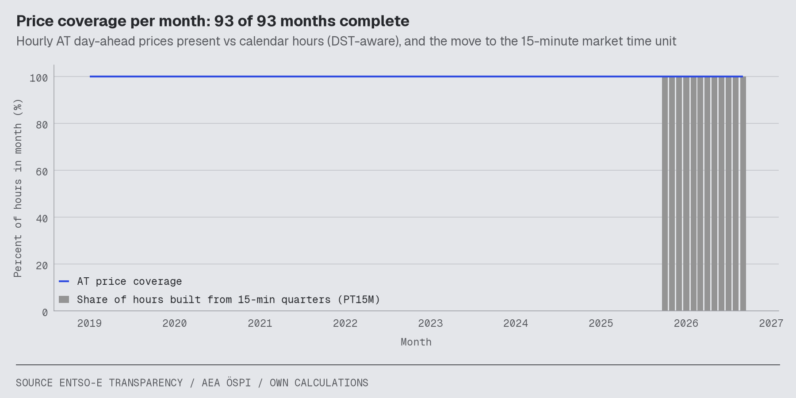

# Data quality report (Datenqualität)

> **FIXTURE RUN — built on SYNTHETIC CI fixture prices (ADR-018), not on real ENTSO-E data. Every number here exercises the pipeline only and is NOT a result.**

Generated by `make report` from `marts.fct_data_quality_monthly` (SQL, dbt-tested) and the last dbt run. Gates behind these numbers: SPEC-01 ingestion gates (`reports/ingestion/`), SPEC-02 dbt tests, AN-304 and ST-602 (see the analytics and strategy reports).

## Kennzahlen

| indicator | value |
|---|---|
| Priced window | 2019-01 → 2026-09 |
| AT price coverage, all months | 100.00% |
| Months below 100% AT coverage | 0 |
| DST transition days (23/25 h) | 15 |
| Months on 15-minute MTU (PT15M) | 12 |
| Negative-price hours, all years | 749 |
| Days since last data month ended | 14 (OK, DM-066 < 40) |

## Coverage and cleanliness per year

| year | expected_hours | priced_hours_at | coverage_at_pct | coverage_delu_pct | coverage_load_pct | coverage_weather_pct | dst_days | hours_from_pt15m | negative_hours | oespi_months | months |
|---:|---:|---:|---:|---:|---:|---:|---:|---:|---:|---:|---:|
| 2019 | 8760.00 | 8760.00 | 100.00 | 100.00 | 100.00 | 100.00 | 2.00 | 0.00 | 0.00 | 12 | 12 |
| 2020 | 8784.00 | 8784.00 | 100.00 | 100.00 | 100.00 | 100.00 | 2.00 | 0.00 | 0.00 | 12 | 12 |
| 2021 | 8760.00 | 8760.00 | 100.00 | 100.00 | 100.00 | 100.00 | 2.00 | 0.00 | 0.00 | 12 | 12 |
| 2022 | 8760.00 | 8760.00 | 100.00 | 100.00 | 100.00 | 100.00 | 2.00 | 0.00 | 0.00 | 12 | 12 |
| 2023 | 8760.00 | 8760.00 | 100.00 | 100.00 | 100.00 | 100.00 | 2.00 | 0.00 | 0.00 | 12 | 12 |
| 2024 | 8784.00 | 8784.00 | 100.00 | 100.00 | 100.00 | 100.00 | 2.00 | 0.00 | 93.00 | 12 | 12 |
| 2025 | 8760.00 | 8760.00 | 100.00 | 100.00 | 100.00 | 100.00 | 2.00 | 2209.00 | 266.00 | 12 | 12 |
| 2026 | 6551.00 | 6551.00 | 100.00 | 100.00 | 100.00 | 100.00 | 1.00 | 6551.00 | 390.00 | 8 | 9 |

## Months below full AT price coverage

None — every priced month is complete.

## dbt tests

**Warehouse build (`make transform`)**

### dbt build results (run_results.json) — PASS

`dbt build` generated_at=2026-10-14T20:46:43.494339Z: pass=64, warn=0, error=0, skip=0

**Cost-mart build (`make simulate`)**

### dbt build results (run_results.json) — PASS

`dbt build` generated_at=2026-10-14T20:46:50.820476Z: pass=7, warn=0, error=0, skip=0

## How to read this

Coverage compares priced hours with the DST-aware calendar (a March month has one hour less, an October month one more), so 100% means no hour is missing. Hours after the 15-minute switch are the mean of four quarter-hour prices, never their sum. Negative-price hours are real market outcomes, not errors, and are kept. Any gap stays NULL: no price is ever invented to fill it (Charter P-1).
